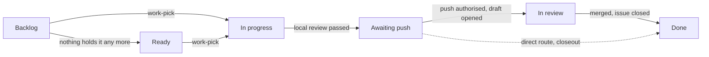

# The board

## Summary

The board is where planned work lives. Each card stands for one issue, and its column says where that work stands.
Use this page to understand what each column means and how the board tools read and move cards. It also says
what a board read can and cannot prove. The [`to-issues`](../.agents/skills/to-issues/SKILL.md) skill files cards, and the
[`resume`](../.agents/skills/resume/SKILL.md) and [`closeout`](../.agents/skills/closeout/SKILL.md) skills move them.
This page owns none of their rules.

The board answers one question: what is planned. A branch and its draft pull request show work in flight, and git
history with passing checks shows what shipped. [`AGENTS.md`](../AGENTS.md#sources-of-truth) sets out that split under
"Sources of truth". A card's column is a field of its own, apart from its issue's open or closed state. Closing an
issue moves its card only where the board's own automation does so. The board tools exist to catch the two drifting
apart.

## Mental model

Every board shows the same six columns, whichever tracker holds the cards. The columns group into four stages.

| Column | Stage | What a card there means |
|---|---|---|
| Backlog | To-do | Filed but not known to be startable, such as a card waiting on an owner decision, an outside dependency or a date |
| Ready | To-do | Startable in the next session, with nothing missing |
| In progress | Active | A session has claimed it and works on it in the job's own worktree |
| Awaiting push | Wait | Local review has passed and the card waits for the owner's push authorisation, so no pull request exists yet |
| In review | Active | The job's draft pull request is open |
| Done | Done | Finished, superseded or not planned; the card makes no further claim |

Backlog and Ready are the pickable columns. Awaiting push waits on the owner, not on a session, so no check treats a
card there as stalled.

The preceding diagram follows one card across the board. The owner picks a card from Backlog or Ready, and it moves to
In progress when its job starts. It reaches Awaiting push once local review passes, and In review once the draft opens.
It ends in Done after the merge closes its issue. The dotted arrow is the direct route. A change pushed straight to
`main` opens no pull request, so closeout moves its card from Awaiting push to Done. [The life of one
change](AI-WORKFLOW-job.md) explains each stage of the job behind these moves.

## How it works

Four scripts make up the board toolkit. `scripts/board.mjs` reads the board, `scripts/board-add.mjs` adds a card,
`scripts/board-move.mjs` moves one, and `scripts/verify-issue-publish.mjs` checks a published issue. The head of each
script owns its modes, argument forms and exit codes. `node scripts/board.mjs --help` prints the read modes without
reading the board.

### Reading the board

One read serves both the listing and its verdict, so the two can never disagree. With no option, the read lists the
pickable cards and then scans the whole board. Other modes list every column or one column, or print the cards as
JSON (JavaScript Object Notation). Two modes serve the skills:

- **Intake**, which `resume` runs, also reads the full details of every pickable card and of every claimed card with no
  closing pull request. It prints a short summary of each and writes each card's full text to its own file, so a session
  reads only the picked card in full. A card whose details it could not read shows as `UNAVAILABLE`, never as empty.
- **Closeout**, which `closeout` runs after a merge, prints every drift row, advisory rows included. It fails only on
  drift that is not advisory and on any card it could not read.

The JSON output lists these fields for each card. The table gives the GitHub meaning. A field that cannot be filled takes
the empty value in the right-hand column.

| Field | Meaning and empty value |
|---|---|
| `number` | The GitHub issue number, or null when the card's content has none |
| `status` | The card's resolved column, or null when absent |
| `title` | The title text, an empty string when missing; an empty title is not a successful detail read |
| `routing` | The resolved routing value, or null when absent |
| `parked` | True when the card sits in the configured parked lane; false when it does not, and always false where none is configured |
| `labels` | The label names, an empty array when none |
| `issueType` | The issue's native type name, or null; present only where the configuration exports native kind types |
| `state` | The issue's open or closed state, or null; it does not replace the card's column |
| `assignees` | The assignee logins on GitHub, an empty array when none |
| `openBlockers` | The numbers of the blockers still open, an empty array when none |
| `closingPullRequests` | One object with a `number` for each closing pull request, an empty array when none |
| `subIssues` | The sub-issue summary with its `total` and `completed` counts, or null; it is not a verified child set |
| `jobBranch` | An object `{ local, remote }` of booleans for the job branch locally and on origin; present only on a Markdown card with one |

On Linear, Jira and Azure Boards, the fields differ from the GitHub meaning in these ways:

- `number` is the identifier string, not an integer.
- `assignees` holds display names on Linear, account IDs on Jira and native identity UUIDs on Azure Boards.
- `closingPullRequests` holds GitHub pull request numbers.
- `routing` is null, `parked` is false and `issueType` is absent, because those exist only on GitHub.
- `subIssues` counts the native children. A child is completed when closed on Linear and Jira, or in Done on Azure
  Boards.

On a Markdown card, the fields differ in these ways:

- `status` is the derived column, not the stored one.
- `labels` holds the one kind label.
- `state` is CLOSED exactly when the published status is Done.
- `assignees` is always empty, because the job branch records the claim.
- `closingPullRequests` lists open pull requests from `job/<N>`, only while the published status is Backlog or Ready.

A null or an empty array is the normalised form, not evidence that the thing is absent. Intake details are not fields of
this output. They are the body, the parent, the comments and the latest claim, and they come from separate detail reads.
`normalizeItem` in `scripts/lib/board.mjs` owns the fields.

The scan reports known drift, a card whose column contradicts a known fact. Examples are a closed issue whose card is
not in Done, and an open issue whose card is in Done. Others are a claimed card with no closing pull request, an open
blocker on a claimed card, and an epic whose children have all closed. Some rows are advisory, because the fact
behind them can change within minutes. `scripts/lib/board-rules.mjs` owns each rule.

The scan also keeps an unreadable card apart from drift. Drift means a card contradicts something known, while an
unreadable card means the scan knows nothing about it. So the scan never claims it covered a board holding an unreadable
card. The exit status keeps a failed read, drift and an incomplete read apart, and each needs a different next step.

### Moving and adding cards

A move writes a card's column and reports whether it wrote it or found the card already there. A batch of moves
stops at the first failure and names the moves already done. It does not undo them, because the writes are separate
remote calls, not one transaction.

Adding a card puts an issue on the board with its column set. On a board with a routing field it also sets that
field, which sends a card to a team or a front of work. The add resolves every value before it
creates anything, so an unknown column or routing value leaves no half-filled card behind. If a field write fails,
the add reads the fields again and reports what it observed. It reports an unknown outcome if that read fails too,
and running the whole command again is safe.

Before either write, the tools read the issue's own board membership. Only a complete, readable reply can prove that
a card is absent. A failed, malformed or cut-short reply refuses instead, so the tools never add a duplicate card by
mistake. [The issue tracker page](ISSUE-TRACKER.md) names the repository's routing convention and how an issue joins
the board.

### Checking a published issue

Once `to-issues` files an issue or an epic, the publication check confirms it. It confirms the real column, the
routing value and the one kind label, or the native issue type where the repository records kind that way. Given
child issue numbers, it requires the native children to match that set exactly. Given none, it reports the real
child count rather than asserting there are no children. A parent and its children are native links, never text in
an issue body.

### The toolkit in another repository

The toolkit copies whole into another repository. `TOOLKIT_LIB` and `CLI_ENTRY_POINTS` in
`scripts/lib/board-toolkit-copy.mjs` name the files it copies, and only `scripts/lib/board-config.mjs` differs. That
file holds the repository's own board values: which project, its owner, its column names and its labels. Three
settings let the same scripts serve a different kind of board. One says whether a user or an organisation owns the
project. One names the field that routes a card, or none on a board that tracks columns alone. One names a lane that
parks a card.

A parked card keeps its column but drops out of the pick view, which lists it on a line of its own. It waits on an
answer from outside the session, so the scan does not report it as a stalled claim. The checks for a blocker, a
missing assignee and an epic still judge it. The JSON output marks every card as parked or not, and a board without a
lane parks no card. `board-config.mjs` owns each setting's name, its accepted values and what each value
changes.

Every call the toolkit makes to GitHub's `gh` command runs through one command prefix. The `BOARD_TOOLKIT_GH`
environment variable can replace that prefix, and the toolkit's tests reach their stand-in for GitHub through it.
They never rely on the search path: on Windows it would skip a stand-in without a file extension and find the real
GitHub. `scripts/lib/gh-exec.mjs` owns the variable's format, its default and what a malformed
value does.

### Other trackers

A repository chooses where its cards live at install, with the `TRACKER` line in `board-config.mjs`. Linear also
needs `LINEAR_TEAM` in that file, Jira `JIRA_CONFIG` and Azure Boards `AZURE_CONFIG`. The same scripts read and move
cards on every tracker, and the board shows the same six columns. Its tracker's identifier, such as `ENG-123`, names
a card on Linear, Jira or Azure Boards. That identifier also names its job branch and the line in its pull request
that closes it.

| Tracker | Where the cards live | What differs | Its page |
|---|---|---|---|
| GitHub Project | A GitHub Project beside the repository's issues | The default; the board's own automation moves some cards | This page |
| Markdown cards | One file per card, `.agents/cards/<N>.md` | The files store only Backlog, Ready and Done. The job branch and its pull request show the other three columns, so the branch is the claim. Suits one person working alone, since another machine sees a claim only after a push; a team chooses a GitHub board | [Markdown cards](MARKDOWN-CARDS.md) |
| Linear | The issues of one Linear team | Linear's own automation moves a card to In review and Done, so the workflow writes the earlier columns and checks those two | [Linear cards](LINEAR-CARDS.md) |
| Jira | One Jira Cloud project | The agent moves every column through Jira's own transitions and reads each back | [Jira cards](JIRA-CARDS.md) |
| Azure Boards | One Azure Boards project | The agent moves every column, each write guarded by the card's revision and read back | [Azure Boards cards](AZURE-CARDS.md) |

Linear, Jira and Azure Boards reach their tracker with a credential kept in a private file on the machine. No
repository, log or cloud environment ever holds it. None of the three has a parked lane, so the tools refuse a lane
request. On Markdown cards and on all three, the add script refuses and names how to file a card there. Jira and Azure
Boards also have no cloud card build and no documentation sweep, and Azure Boards has no direct route to `main`. A
repository that outgrows Markdown cards moves them onto a GitHub board with one installer command, as [Moving to a
GitHub board](MARKDOWN-CARDS.md#moving-to-a-github-board) describes. Each tracker's page owns its setup, its claim and
what each card step becomes.

### The board's own automation

A GitHub Project carries automation of its own, on its Workflows page rather than its settings. The workflow icon in
the project's header opens that page. These choices keep the agents from moving a card for the cases the board
handles itself.

| Board workflow | State | Setting | Why |
|---|---|---|---|
| Auto-add to project | On | `is:issue is:open` on the repository | An issue joins the board when it opens, before anyone triages it |
| Item added to project | On | Status: Backlog | An added card lands in Backlog, the column `to-issues` and `resume` add to |
| Auto-add sub-issues to project | Off | | It would add sub-issues from other repositories, which the scripts cannot read; a repository's own sub-issues already arrive through Auto-add to project |
| Item closed | On | Status: Done | The move to Done happens at merge time with no agent involved; the move script reads the column back and skips its own write |
| Auto-archive items | On | `is:issue,pr is:closed updated:<@today-2w` | Keeps the active board small; archiving never deletes a card, so history stays |
| Pull request linked to issue | Off | | Awaiting push and In review follow push authorisation and the draft opening, not a link appearing |
| Pull request merged | Off | | The issue's close, through the pull request's closing line, already triggers Item closed |
| Item reopened | Off | | A reopen is a quality signal the session records on purpose; an automatic move would upset the Awaiting push and In review order |
| Code changes requested | Off | | The `resume` skill's own review records track review state, not the board |
| Code review approved | Off | | The same reason as Code changes requested |
| Auto-close issue | Off | | An issue closes through its pull request's closing line, never because of a card's column |

### Proposals from the weekly retro

The weekly retro, in a repository that runs it, files proposal cards and changes nothing else. It reads the week's
merged pull requests, their Review sections and the failed checks, and files at most five proposals. The board's
auto-add lands each in Backlog, and the next local session fills in its routing value. A proposal is never agreed
work: the owner picks it at work-pick or closes it. That is why the issue tracker page lets the retro file without the
usual `to-issues` approval. No script in the repository makes the retro's judgments or checks them. A change pushed
straight to `main` has no pull request, so the retro never reads it. [The weekly retro manual](WEEKLY-RETRO.md) owns
what it reads, how it ranks and files proposals, and its card check.

## Where the rules live

- [The issue tracker page](ISSUE-TRACKER.md): the repository's tracker, how an issue joins the board, the routing
  convention, the labels and the filing exceptions.
- `scripts/lib/board-config.mjs`: the repository's own board values, and the settings that let the scripts serve
  another board.
- The heads of `scripts/board.mjs`, `scripts/board-add.mjs`, `scripts/board-move.mjs` and
  `scripts/verify-issue-publish.mjs`: each command's modes, argument forms, output streams and exit codes.
- `scripts/lib/board-rules.mjs`: each drift rule, and which rows are advisory.
- `scripts/lib/gh-exec.mjs`: the `BOARD_TOOLKIT_GH` contract.
- [Markdown cards](MARKDOWN-CARDS.md), [Linear cards](LINEAR-CARDS.md), [Jira cards](JIRA-CARDS.md) and
  [Azure Boards cards](AZURE-CARDS.md): each tracker's setup, claim and card steps.
- [The `resume` skill](../.agents/skills/resume/SKILL.md): when a session moves a card, what Ready means, and the
  candidate table the owner picks from.
- [The `closeout` skill](../.agents/skills/closeout/SKILL.md): the move to Done and the strict board check after a
  merge.
- [The `to-issues` skill](../.agents/skills/to-issues/SKILL.md): how the agents propose, file and verify cards.
- [The weekly retro manual](WEEKLY-RETRO.md): the retro's reads and proposals.

## Failure modes

| Situation | What shows it | What happens next |
|---|---|---|
| The board read fails, or a GitHub board returns no cards | The read exits non-zero and names the cause | Once access returns, the session reads again; a failed read is never an empty backlog. An empty Linear, Jira or Azure Boards board is a real empty board |
| A read is incomplete | An advisory names what could not be read; intake shows `UNAVAILABLE` details | The owning skill uses only what it read and reads again; an incomplete read is never a clean board |
| A card's column disagrees with its issue | The scan names a closed issue outside Done, or an open issue in Done | The owning skill reconciles it. Someone reopened an open issue whose closing pull request merged, so it never counts as shipped |
| GitHub's project listing leaves out a card | The board and publication commands name each recovered card on stderr | The read walks the repository's issues and recovers the card, so nothing adds it again; inconsistent recovery evidence fails the read |
| Automation adds a card with no routing value | The scan reports the card until someone fills the field | The add script fills the field on the card already there, with the value the tracker page's convention gives |
| Auto-add is off | A filed issue never reaches the board; a board copied from another starts with it off | Every issue joins through the add script, as the head of `scripts/board-add.mjs` says |
| A batch move or a field write stops partway | The report names what completed, what it observed and what is unknown | The named recovery runs; nothing assumes the writes happened together |
| The publication check finds a card missing | It names a card it could not find, an archived card or an unresolved read | The session unarchives an open archived card rather than adding it again, adds a confirmed absence and repeats an unresolved read |
| A tracker other than GitHub cannot be read | The cause names the setting, page or tracker rule that refused | The session corrects it as the tracker's page says; a failed read is never an empty board |
| A tracker adapter's tests pass | Its synthetic workflows are green | They prove the parts fit together; live writes to Jira or Azure Boards need their own executed evidence |

A board read shows the cards as the tracker reports them. It is not a full audit of the tracker's consistency, and
its drift rules cover the known cases only. The automation table records the settings the workflow expects on a
GitHub Project, not the settings a given board holds. Only a fresh read of that project's Workflows page shows that.

## Key files

- `scripts/board.mjs`, `scripts/board-add.mjs` and `scripts/board-move.mjs`: read the board, add a card, move a card.
- `scripts/board-claim.mjs`: checks that a picked card is still free and claims it, on the GitHub Projects tracker only.
- `scripts/verify-issue-publish.mjs`: checks a published issue and its children.
- `scripts/lib/board-config.mjs`: the one file that differs between repositories.
- `scripts/lib/board-rules.mjs`: the drift rules.
- `scripts/lib/board-markdown.mjs`: the reader and mover for cards kept as files.
- `scripts/lib/board-linear.mjs`, `scripts/lib/board-jira.mjs` and `scripts/lib/board-azure.mjs`: the reads and moves
  for Linear, Jira and Azure Boards cards.
- `scripts/linear-card.mjs`, `scripts/jira-card.mjs` and `scripts/azure-card.mjs`: the card commands for each of those
  trackers, with their libraries under `scripts/lib/`.
- `scripts/lib/linear-api.mjs`, `scripts/lib/jira-api.mjs` and `scripts/lib/azure-api.mjs`: each tracker's API calls and
  the private credential they read.
- `scripts/lib/board-toolkit-copy.mjs`: test support that loads the toolkit from a copy with a fixed configuration, so
  no shipped board test reads a repository's own `board-config.mjs`.
- `scripts/lib/gh-exec.mjs`: the one route every `gh` call takes.
- `scripts/lib/fake-gh.mjs`: the stand-in for GitHub that the tests reach through `BOARD_TOOLKIT_GH`.

## Where to go next

- [The life of one change](AI-WORKFLOW-job.md) shows when a job moves its card.
- [The evidence bar](AI-WORKFLOW-evidence.md) explains what a passing check proves, on the board and elsewhere.
- [Enforcement and instruction](AI-WORKFLOW-enforcement.md) separates what a machine refuses from what rests on an
  instruction.
