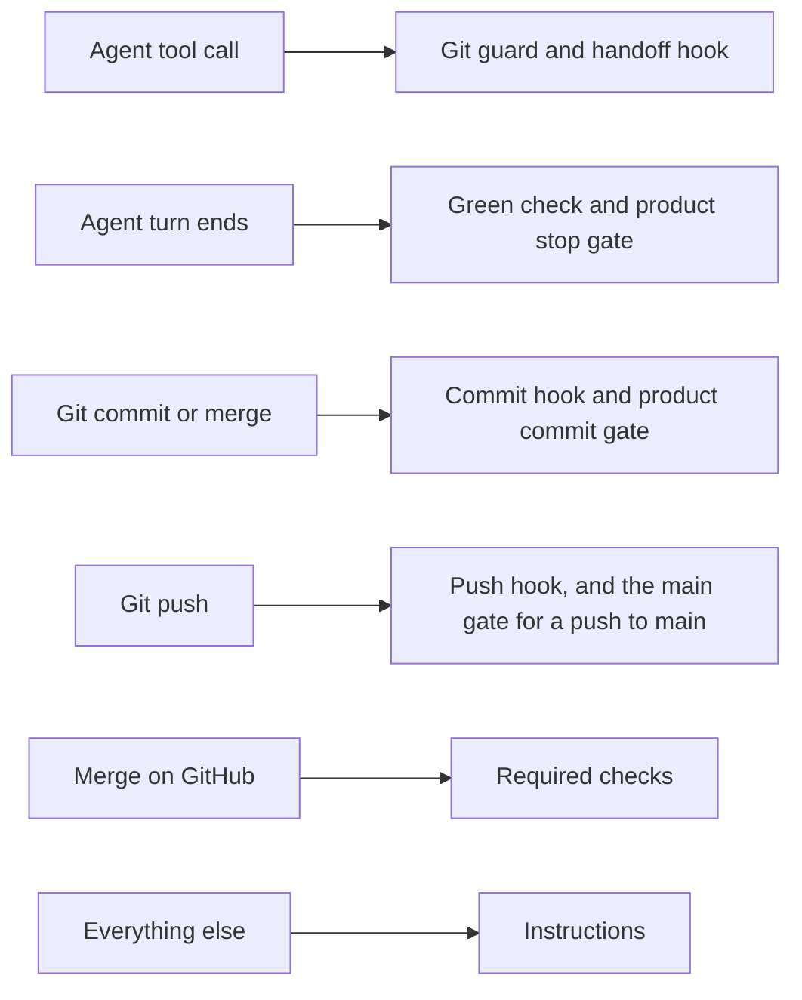

# Enforcement and instruction

## Summary

Most of the workflow is a sentence an agent follows. A machine holds a short list of controls instead: a runtime
hook, a git hook or a check on GitHub. Use this page to see which controls exist, what sets each one off and what each
one cannot establish. It also explains why the list stays short.

The controls catch mistakes. They do not make every forbidden action impossible, and each sees only the input its
trigger hands it. The standing security guarantees in [`AGENTS.md`](../AGENTS.md#surfaces), under "Surfaces", say
which outcomes the repository promises to keep. This page explains the machinery behind them and owns none of their
rules.

## Mental model

The preceding diagram shows six separate triggers and what each one reaches. Each row is its own boundary, not a stage
of one pipeline, so passing one row says nothing about another. A runtime hook runs only when the runtime has loaded
and trusted it. A git hook runs only where git hooks are switched on. Everything outside these triggers rests on an
instruction.

| Control | When it runs | What it refuses or forces | What it cannot establish |
|---|---|---|---|
| Git guard | Before every shell command an agent submits | The unsafe git and GitHub command forms the head of `scripts/lib/unsafe-git.mjs` lists | What a wrapper or a started program does; a server-side limit |
| Cleanup approval | Before a shell command, in a Claude Code session at the trusted root | A direct cleanup call that lacks the trusted root's context | Protection from a hostile interpreter or a changed trusted root |
| Handoff hook | Before a helper is dispatched, and on Codex before every tool call | A handoff with a missing line or an unfilled slot, and a builder told to prove its own mutation | Whether the plan is sound, or whether the builder follows it |
| Green check | When an agent's turn ends | Ending a turn on a lint error in pending source changes, after any product stop gate | A check it could not run, which it states as unverified; changes in another checkout |
| Product gates | At turn end, and on every commit | A turn end or commit whose gate exits non-zero or is not executable | Anything, where the repository supplies no gate |
| Test output filter | Before every shell command on Claude Code | Condenses a green test run and passes a red one through in full | Nothing; it changes only what the session reads |
| Generated artifacts | The product gates, an auto-committing merge, and continuous integration | A generated artifact that is not the exact build of its source | A repository without gates relies on the checks its Conventions table names |
| Seat definitions | On every commit | A seat file the runtime would silently drop, and charter bodies that differ between the runtimes | The runtime settings around a charter, which are checked separately |
| Push hook | On every push | A red lint run or script suite, and a push to `main` the gate on the remote's `main` does not admit; lint and the suite are skipped for a push to `main` that gate marks setting-only, a gate that checks the changed seats itself | Any push made with the hook skipped, missing or changed |
| Git LFS upload | Last in the push hook, where the push uses Git LFS | A push needing Git LFS from a machine without `git-lfs`, and a failed upload | Some attribute sources the hook does not read |
| Shared-file contract | The contract test, in the push hook and continuous integration | A listed shared file that differs from its recorded fingerprint, apart from a seat setting value | That the shared text is correct, only that it is the recorded text |
| Required checks | When GitHub merges a pull request | A merge before every required check is green | A merge by an identity that may bypass the rule |
| Browser run prompt | When Codex starts a browser run, where `.codex/rules/playwright.rules` exists | A browser run with no prompt first | Anything about a browser run on Claude Code |

## How it works

### Runtime hooks

Each runtime reads its own registration file. On Claude Code, `.claude/settings.json` runs the git guard and the test
output filter before every shell command. It runs the handoff hook before every helper dispatch and the green check at
turn end. On Codex, `.codex/hooks.json` runs the git guard before every shell command and the handoff hook before every tool
call and when a helper starts. It runs the green check at turn end, with its own command form for native Windows.
Codex finds its hooks through the repository's shared git directory, so every worktree of the repository runs the same
hooks. A Claude Code session started at the root checkout keeps that root's git guard after it enters a job worktree.

A registered hook is configuration, not proof that the hook ran. A runtime must load the hook and its user must trust
it before it runs at all. The Codex hooks read the command and its working directory from the event Codex sends, as
`scripts/lib/codex-hook-adapters.mjs` defines. [Two runtimes, one contract](AI-WORKFLOW-runtimes.md) explains how the
hooks run on each runtime and platform.

### The handoff hook on each runtime

On Claude Code, the hook reads the text of every helper dispatch before the helper starts. It checks builder and
architect handoffs against their templates. It also limits a protected seat, such as the architect, to dispatching
the `explorer` alone.

On Codex, the dispatched text reaches the hook encrypted, so the hook checks a saved copy instead. The coordinating
session saves each builder handoff as `.claude/worklog/handoffs/<task_name>.md` before it dispatches. The hook takes
that file from whichever of the repository's worktrees holds it. It refuses a builder dispatch without a passing saved
handoff, and a second builder dispatch while an earlier builder has not started. When the builder starts, the hook
binds the handoff to it and shows the handoff to the builder. It then refuses every tool call of a builder thread that
started with no bound handoff. On Codex the hook checks no architect handoff. It cannot see hosted tools, or shell
commands on native Windows, and it refuses any event it cannot read. The shared check behind both hooks lives in
`scripts/lib/handoff-check.mjs`.

### Cleanup approval from the trusted root

Cleaning up a finished job's worktree and branch needs approval, and no standing permission rule grants it. Instead, the
Claude Code git guard at the trusted root can approve one exact cleanup command. The hook first works out the root from
its own file location. It then requires two directories to resolve to that same main working tree: the one the command
was submitted from and the hook's own. It also checks that the cleanup helper sits at the expected path under that
root.

A different main checkout, or a matching helper inside a job worktree, does not satisfy these checks. Every other
guard refusal still comes first. Once the checks pass, the hook returns the runtime's native allow decision, as
[Claude Code's hook reference](https://code.claude.com/docs/en/hooks#pretooluse-decision-control) describes. It does
so only for the command form [the `closeout` skill](../.agents/skills/closeout/SKILL.md) gives in step 5. The hook
refuses a direct cleanup call without the trusted context, and quoting, redirection or a compound command does not get
it past that refusal.

Any other command form gets the runtime's ordinary permission review, separate from this approval. That includes an
absolute path to a detached verifier's helper. Whatever approves the command, the helper's own checks still decide what
it removes. They check who created a target, whether it is in use and its Docker containers. The approval assumes
intact files at the trusted root and a trusted host and interpreter. Matching helper bytes do not pin the interpreter.

### Git hooks and their activation

The git hooks live in `.githooks/` so they travel with the repository. Installing the root's packages points git at
them through `core.hooksPath`, as [the git hooks manual](../.githooks/README.md#activation) explains. Continuous
integration does not rely on these hooks, and runs the same checks as explicit steps.

- **On commit,** the hook checks every staged seat file. Each must parse, and no Claude seat may carry an
  `initialPrompt` key, which never reaches a helper. The two runtimes' charter bodies must match apart from how they
  invoke a skill.
- **Seat reads,** for that check, use staged files and the staged validator. The hook checks installed seats for the
  runtimes the staged settings name, and canonical seats under `src/` for both runtimes.
- **After the seat check,** the commit hook reports stale prose in staged documents as advice, never a refusal. It
  then runs the product commit gate where one exists.
- **On a merge** that would commit by itself, a separate hook runs the commit hook, so the product gate sees that
  case too.
- **On push,** the hook runs lint and the script suite. A push to `main` first runs the gate as it stands on the
  remote's `main`, from a copy of that commit's tree. So a commit can never admit itself by changing the gate. When
  every ref goes to `main` and that gate exits 0 printing exactly `setting-only`, the hook skips lint and the suite,
  because the gate has checked the changed seats itself.
- **Last on push,** once every other check has passed, a push that uses Git LFS uploads its objects.

A charter mismatch names the seat, both files and the lines that differ. The canonical repository repairs both source
charters together, and an adopting repository receives the repair through a release update. When the shared-file
contract test fails, its message points to the fix. That is canonical recording in the canonical repository, a release
update in an adopter, or the render command for a seat setting. A canonical repository may also supply its own commit
gate that records shared-file fingerprints, and its profile in `.agents/REPOSITORY.md` says whether it does. That gate
does not travel to adopters, and the fingerprint checks still judge what it records.
[The `shared-files` skill](../.agents/skills/shared-files/SKILL.md#canonical-recording) owns how the canonical
repository records a fingerprint and recovers from a refused recording.

### Checks on GitHub

Two branch rulesets protect `main`, and one of them requires the repository's checks to pass. Those checks are `test`,
and `sweep-scope` where the documentation sweep is on and active. Auto-merge then merges a ready pull request once
they pass. On a draft pull request, `test` reports under a different name, so a draft can never satisfy the rule.

The administrator role can bypass the required checks, and the direct route to `main` relies on that. GitHub admits a
write deploy key by the same bypass. So only the local push hook judges a push to `main` from either.
[The `shared-files` skill](../.agents/skills/shared-files/SKILL.md#administrator-bypass) says who may hold that role. A ruleset's file or a workflow's
configuration does not show GitHub's settings right then, or who holds the role. Only a read of the repository's
settings on GitHub shows that.

### What stays an instruction, and why the list is short

Everything the controls do not cover is a sentence in `AGENTS.md` or a skill. That includes which reviewer runs, when
to stop and replan, what a pull request body says, the owner gates, a job's scope and its cleanup. An instruction says
what to do. Nothing in the repository observes whether an agent did it.

The list stays short on purpose, because every control costs upkeep. When a real failure exposes a weakness, the lesson
goes in at the cheapest layer that would have caught it. A sentence comes first, and then evidence where behaviour can
show the failure. A guard comes only when the failure recurs despite the sentence. It comes at once when the bad state
would be silent, misleading, security-sensitive or hard to reverse. The change that adds a guard names a recovery
route that destroys nothing. The guard replaces any stale guidance rather than becoming a second authority.
[The `resume` skill](../.agents/skills/resume/SKILL.md#4-plan) states the bar machinery must clear, as its machinery rule
under "4. Plan".

## Where the rules live

- [`AGENTS.md`](../AGENTS.md#surfaces) under "Surfaces": the standing security guarantees and the repository's
  highest-consequence surfaces.
- [`AGENTS.md`](../AGENTS.md#publication-and-machinery) under "Publication and machinery": the direct route and the
  preference for a sentence over a hook.
- [The `resume` skill](../.agents/skills/resume/SKILL.md#4-plan) under "4. Plan": the machinery rule, which says how
  machinery enters, grows and leaves, and the tooling size report given only when the owner asks.
- The head of `scripts/lib/unsafe-git.mjs`: every command form the git guard refuses, and what it does not model.
- `.claude/settings.json` and `.codex/hooks.json`: which hook runs on which event.
- [The git hooks manual](../.githooks/README.md): what the commit, merge and push hooks enforce, and what the main gate
  may rely on.
- [The `closeout` skill](../.agents/skills/closeout/SKILL.md): the cleanup command, its activation checks and the two
  verified branch exceptions.
- [The `shared-files` skill](../.agents/skills/shared-files/SKILL.md#canonical-recording): recording a shared file and
  recovering from a refused recording.

## Failure modes

- **A runtime has not loaded or trusted the hooks.** A committed registration shows only what the file configures. It
  cannot show that a running session loaded and trusted the hook. Where the session cannot observe that, its delivery
  report names the limit. A check that the git guard refuses a command does not show that the runtime trusts the
  handoff hook or the turn-end check. The `closeout` skill owns the checks for cleanup approval and their recovery.
- **An agent wraps or disguises a command.** The git guard reads the command an agent writes. Apart from a plain `env`
  prefix, it does not look inside a wrapper, so it catches accidents and is not a security boundary. The head of
  `scripts/lib/unsafe-git.mjs` says what it does not model.
- **Someone skips or changes the push hook.** Git runs the push hook from the checkout that pushes. Nothing judges a
  push at all when its hook is skipped, missing or changed in that checkout. The same holds when someone changed the
  git configuration or attribute files that push reads. For an identity that can bypass the rulesets, nothing on the
  server judges that push either.
- **A reader takes a permission prompt for a boundary.** The runtime's prompt before a push is a checkpoint for
  approval. The git guard reads the submitted command, not what a program that command starts does later. So nothing
  in the repository shows that every way of publishing meets that prompt. A push allowed to run with no prompt would
  first need a boundary on the server.
- **A guard refuses something legitimate.** The refusal keeps its target, and the session reports it with the evidence.
  It reads the cause, keeps the protected outcome and returns to its task. A fix that would change what a guard refuses
  is a sign-off change under the Surfaces table, with its own named test. The `closeout` skill's step 5 holds the only
  standing exceptions, two verified branch cases. One is the exact merged job head, and the other a backup branch the
  session made before squashing. They are instructions to the session, not a permission the runtime grants.

## Key files

- `.claude/hooks/` and `.codex/hooks/`: the runtime hooks.
- `.claude/settings.json` and `.codex/hooks.json`: each runtime's hook registration.
- `.githooks/`: the commit, merge and push hooks.
- `scripts/gates/stop`, `scripts/gates/pre-commit` and `scripts/gates/pre-push-main`: the repository's own optional
  gates.
- `scripts/lib/unsafe-git.mjs`: the git guard's rules.
- `scripts/lib/handoff-check.mjs`: the shared handoff check.
- `scripts/lib/codex-hook-adapters.mjs`: how the Codex hooks read an event.
- `scripts/lib/check-agents.mjs`: the commit check that compares charters across the runtimes.
- `scripts/lib/workflow-contract.test.mjs` and `.agents/factory-manifest.json`: the shared-file contract and the list
  it checks.

## Where to go next

- [Two runtimes, one contract](AI-WORKFLOW-runtimes.md) explains how the hooks run on each runtime and platform.
- [The evidence bar](AI-WORKFLOW-evidence.md) explains what a passing check proves.
- [The seats](AI-WORKFLOW-seats.md) explains what each seat does and how a handoff passes between them.
