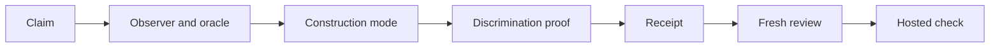

# The evidence bar

## Summary

A green check proves only what that check observed, on the inputs it ran against. It cannot show that the check was
the right one for the claim. Use this page to understand how the workflow chooses evidence for a change and records each
check. It also says what a recorded result can and cannot prove. Read it before you judge whether a job's evidence
supports what its pull request says.

Each repository's [testing strategy](TESTING-STRATEGY.md) owns which evidence a claim needs. The
[`resume`](../.agents/skills/resume/SKILL.md) skill owns when each check runs and how review settles. This page explains
how the pieces connect, and owns none of their rules.

## Mental model

Evidence for a change forms a chain. Each link answers one question, and a later link cannot repair a missing earlier
one.

| Link | The question it answers | Who settles it |
|---|---|---|
| Claim | What observable behaviour or rule does this change promise? | The plan |
| Observer and oracle | Which check can see that behaviour, and where does its expected result come from? | The plan, before any build |
| Construction mode | Must a failing check come before the fix, or does it only need to exist by the end? | The plan proposes; the coordinating session validates |
| Discrimination proof | Does the check fail on a plausible wrong version of the code? | The coordinating session, at convergence |
| Receipt | What exit code did the check really return, and on which tree? | `scripts/run-log.mjs` |
| Review | Does an independent reader agree the claim is met and the evidence fits it? | A fresh reviewer, on the final tree |
| Hosted check | Does the merged result still pass where the repository's required check runs? | Continuous integration, before the merge |

The preceding diagram reads left to right, in the order a job settles each link. A pull request quotes every link it
relies on. A gap anywhere in the chain stays a gap, however green the links after it look.

Four kinds of evidence answer different questions, and none stands in for another.

| Kind | What it shows |
|---|---|
| Inspected test | What a test's assertions cover, read without running it |
| Executed check | The exit code a command returned, as its receipt records |
| Semantic review | An independent reader's judgment of meaning, where no executed check can observe it |
| External observation | What a scoped read or probe of a live system showed at one moment |

## How it works

### Choosing what to observe

Every claim names one behaviour or rule a reader could observe. Adding code is not a claim. Neither a test
count nor a coverage figure measures correctness. The plan then chooses the cheapest observer that can see the claim.
A pure calculation needs a unit test, while command wiring, stored state and output honesty each need their own kind
of observer. Lint shows that code follows its rules, never that it behaves correctly.

The expected result comes from somewhere the code did not: a requirement, a hand-worked example or a known-good
fixture. A test that copies the production calculation agrees with that calculation whether it is right or wrong. So
an implementer's own test is never the only oracle for its own work.

### Construction modes

Each claim gets one of three construction modes. Its subject sets a minimum mode, and difficulty never lowers it.

| Mode | When it applies | What it requires |
|---|---|---|
| `strict-tdd` | A reproducible defect, or a consequential rule whose missing safeguard shows on the running system | A logged meaningful failure before any fix, then the same check green after it |
| `evidence-required` | Ordinary added or changed behaviour | Added or strengthened evidence and a discrimination proof by convergence, in whatever build order |
| `preservation` | Behaviour already present at the job's base, with adequate evidence and an unchanged contract | The declared evidence stays green; no added test or mutation |

A repository's testing strategy can raise the minimum mode for its own subjects, such as security or privacy. A
failure counts as meaningful only when it shows the claimed defect through the code's public interface. A broken test
setup or a reference to code that does not exist yet does not count.

The session hands a `strict-tdd` claim to builders in two handoffs. A test-only builder writes the check and logs its
meaningful failure, and an expected failure is a valid result for that stage. The coordinating session reads the diff
and the receipt, records its verdict in the job's worklog and fixes the test contract. Only then does an implementation
builder make the check pass. A distinct safeguard found later stops for classification, and a wrong oracle stops for
revalidation. No builder edits the fixed assertions to reach green.
[The builder template](../.agents/templates/builder-handoff.md) carries the stage. No hook checks this order, because an
exit code cannot say why a test failed.

### When no runnable baseline exists

Some claims have nothing to run before the change, so no meaningful failure is possible. The plan then fixes the
acceptance examples and their independent expected values first. It names a sufficient alternative: its observer, its
build steps and its discrimination proof. Review alone cannot prove executable behaviour. Behaviour a job added
earlier never counts as present at the job's base, so it cannot move to `preservation`.

A text-only change, such as a documentation or instruction change, has no executable observer for its meaning. Where
it changes what a reader or agent must do, documentation lint is its mechanical check. The fresh review of the final
tree then stands in for a mutation. Text that is only reworded or moved keeps documentation lint green as its
protected contract. The [`fabraik-setup`](../.agents/skills/fabraik-setup/SKILL.md) skill proposes these choices to a
repository adopting the workflow, for its own confirmation. That repository's own strategy, and any stricter rule in
it, stays in force.

### Proving the check discriminates

A useful check fails on a plausible wrong version of the code and passes on a correct one. Two routes prove that. The
first is a qualifying failure logged before the fix, followed by the unchanged check passing after it. The second is
a mutation: the coordinating session breaks the code on purpose, sees the check fail, restores the code and sees it
pass. A builder never runs a mutation cycle. Every changed protected rule, such as a trust or honesty rule, keeps one
deliberate mutation even when a qualifying failure exists.

Nobody can recreate a missed sequence afterwards. A later mutation can show the check discriminates on the
code as it stands, never that a failure came first. The final audit under "6. Verify and review" in the `resume` skill
keeps that gap visible and leaves the decision with the owner. A saved record of the gap is never fresh
authorisation.

### Recording each check

Every executed check runs through `scripts/run-log.mjs`, which starts the command and appends one receipt to the
job's worklog. The receipt holds the label, the exact command, the exit code it really returned and the time in
Coordinated Universal Time (UTC). It also records the tree's state before and after the run. That state is the commit,
whether the tree was clean and a fingerprint of the uncommitted changes.

The receipt keeps outcomes apart that would otherwise read the same:

- The logger records a command that could not start as a spawn failure with exit 127, so it never reads as a failing
  test.
- The logger records a command a signal ended as such, never as a completed run.
- A receipt the logger could not write turns a passing run into exit 1, so no session claims an unrecorded pass.
- A tree whose state the logger could not read shows `unknown`, never `clean`.

The fingerprint is what makes a mutation receipt checkable. A mutation's failing run must show a fingerprint that
differs from the passing run's, on the same commit. A matching fingerprint shows nobody changed the code, and the
reviewer refuses that receipt. A session gives a reason for each rerun it starts, and the receipt records it word for
word. The logger never guesses that a run was a rerun. With no reason it records none, and it refuses a blank reason
before the command starts. Nothing else reads the worklog. The head of `scripts/run-log.mjs` owns the exact format.

### Receipts after a later commit

A receipt describes the commit and the tree it ran on. A receipt taken over uncommitted changes supports work in
progress, but it is not the final evidence for publication. A commit added afterwards leaves every earlier receipt
naming an older commit, yet not every check runs again. The session lists the paths the later commit changed. The
repository's testing strategy maps those paths to the checks they can affect, and only those run again.

A check also runs again when it depends on an input no path shows, such as an installed dependency. The same holds
when its earlier run is known to be invalid. After a rebase onto a moved `main`, one bounded case lets a local
receipt stand in for a check the hosted run also covers. The pull request body lists every carried receipt with the
commit it ran on and the paths that changed. So no reader takes it for a run on the final commit.
[The delivery reference](../.agents/skills/resume/references/deliver.md) owns these cases under "Receipt reuse".

### Checks before a merge

The repository's continuous integration runs its required check on the pull request's merge result, not its branch
head, so it tests what would land. It runs on the final commit, whatever receipts were carried. The check reports a
result once the session marks the draft ready. A change pushed straight to `main` triggers none of these pull request
checks. The testing strategy records which suites the hosted check runs, on which platforms, and which run only
locally.

Where the documentation sweep is on, a second check, `sweep-scope`, guards the sweep's and its triage's branches. Those
routines land their own pull requests, and no person reads them first. So the check runs from `main`, never from the
pull request it judges, and holds those branches to the scope table both routines answer to. On any other branch it
reports as passing. The head of `scripts/sweep-scope-check.mjs` and `docs/DOC-SWEEP.md` own what it refuses.

### Review as evidence

One fresh review reads the final tree and its evidence before the pull request opens. It challenges both the change
and the evidence chosen for it. The reviewer derives the claims from the card and the final diff before it reads the
selected evidence. So a downgraded mode shows up as a finding. A builder repairs a true finding, and the session
verifies it again.
[The review line](AI-WORKFLOW.md#the-review-line) records the review that ran. A correctly formatted line shows the
format is right, never that a review took place.

## Where the rules live

- [The testing strategy](TESTING-STRATEGY.md): observers and oracles, the construction modes and their minimums, the
  discrimination routes, the receipt fields and which suites run where.
- [The `resume` skill](../.agents/skills/resume/SKILL.md#5-build) under "5. Build": that every check runs through the
  logger, and the rerun reason.
- [The strict construction reference](../.agents/skills/resume/references/strict-construction.md): the two handoffs of
  a `strict-tdd` claim.
- [The `resume` skill](../.agents/skills/resume/SKILL.md#6-verify-and-review) under "6. Verify and review": the review
  tiers, the repair rounds and the final audit of a missed sequence.
- [The delivery reference](../.agents/skills/resume/references/deliver.md): receipt reuse after a later commit or a
  rebase.
- The head of `scripts/run-log.mjs`: the receipt format, its exit codes and its platform handling.
- [The coding standards](CODING-STANDARDS.md): what a test or tool may cost.
- [`AGENTS.md`](../AGENTS.md#coding-standards-and-the-executed-test-bar) under "Coding standards and the executed test
  bar": which document owns which part of the evidence bar.
- The head of `scripts/sweep-scope-check.mjs` and `docs/DOC-SWEEP.md`: what the `sweep-scope` check refuses, where the
  sweep is on.

## Failure modes

| Situation | What shows it | What follows |
|---|---|---|
| A test passes whatever the code does | A mutation leaves it green | It is not evidence; the claim needs a check that fails on the mutation |
| A test run selects no tests, or the wrong ones | The receipt shows fewer tests than the handoff named, or none | The verification failed; zero tests is never a pass |
| A check could not run | The receipt shows a spawn failure, or no receipt exists | The claim stays unproved, and the session reports it as unavailable, never as a pass |
| The failure came from broken setup | The red run fails before reaching the claimed behaviour | It is not meaningful red, and the session classifies the evidence again |
| A reader takes later evidence for earlier history | Someone offers a mutation to show a failure came first | The gap stays recorded and goes to the owner; nobody can rebuild history |
| A reader takes a carried receipt for a fresh one | The pull request body's carried lines name an earlier commit | The reader judges it by the carry rule, not as a run on the final commit |
| A reader takes a configured check for a passed one | A workflow, schedule or routine exists, but nobody read a run of it | Only an observed run shows a result; configuration shows intent |
| A reader takes a green documentation check for accurate prose | Documentation lint or a scope check passes | It shows the form and scope are right. It never shows that the prose is true, that each changed link reaches its target, or that the change may merge |
| A reader infers a design reason from the code | A choice has no recorded reason | The code shows what someone built, not why; an unrecorded reason stays unknown, and git history is where to look |
| A reader takes an old assessment for a current one | A recorded audit or advisory predates the change | It shows what held when it was made; a current claim needs its own scoped assessment |
| A reader assumes a review from its line | A well-formed review line, but no recorded findings or verdict | Only the reviewer's recorded verdict shows the review ran |

The agents never turn missing evidence into a pass, a blank or a zero. Where an observation was not available, the
pull request says so, and the related part of the claim stays unproved.

## Key files

- `docs/TESTING-STRATEGY.md`: the repository's own evidence rules.
- `docs/CODING-STANDARDS.md`: the test economics standard.
- `scripts/run-log.mjs`: the logger every check runs through.
- `.github/pull_request_template.md`: where the session records the claims, the evidence and any carried receipts.
- `.github/workflows/sweep-scope.yml` and `scripts/sweep-scope-check.mjs`: the scope check for sweep and triage
  branches, where the sweep is on.

## Where to go next

- [The life of one change](AI-WORKFLOW-job.md) shows where each check runs in a job.
- [Enforcement and instruction](AI-WORKFLOW-enforcement.md) separates what a machine refuses from what rests on an
  instruction.
- [The board](AI-WORKFLOW-board.md) explains what a board read can and cannot prove.
