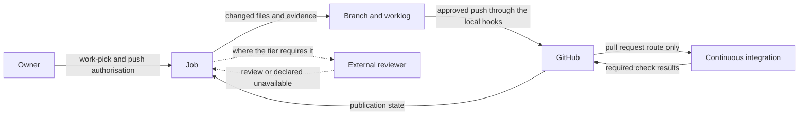
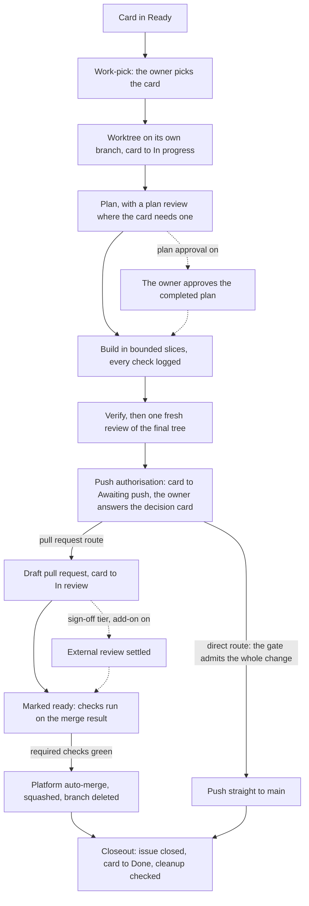

# The life of one change

## Summary

A job takes one approved card to one commit on `main`. This page follows that path stage by stage: who acts, what
each stage leaves behind and what a machine holds there. Use it to understand a job before you run one, or to see
where a stopped job stands. The exact steps are in the [`resume`](../.agents/skills/resume/SKILL.md) and
[`closeout`](../.agents/skills/closeout/SKILL.md) skills, and this page owns none of them.

A finished job leaves four things: the approved outcome in git history, a receipt for each check, a recorded review
and a matching board. Together they form a trail from the card's acceptance criteria to the job branch, its
receipts and the publication record. That record is the pull request, or the commit message on the direct route. A
later session reads the trail to tell intended, unfinished and shipped work apart, without the conversation behind it.

## Mental model

Every job passes through the same stages in the same order. The session that talks to the owner coordinates each one,
and [The seats](AI-WORKFLOW-seats.md) shows which agent it hands each piece of work to.

| Stage | Who acts | What it leaves | What a machine holds |
|---|---|---|---|
| Start | The owner picks the card; the session confirms it is free and claims it | A worktree on its own branch, a claim comment and the card in In progress | The git guard refuses branching and committing in the root checkout |
| Plan | The architect or the session, with a plan review where the card needs one | A plan naming each slice's files and claim | The handoff hook refuses an incomplete architect handoff on Claude Code |
| Build | A builder seat, one slice at a time | A commit for every green slice and a receipt for every check | The handoff hook refuses an incomplete builder handoff, and the green check refuses a turn that ends on a lint error |
| Review | The reviewer at the tier the change needs, and the security reviewer when the trust perimeter widens | Settled findings and a review line | Nothing: review rests on instruction |
| Push authorisation | The owner | One yes to the decision card and its screenshot | Nothing: the yes rests on instruction |
| Delivery | The session, then the platform | A draft pull request, checks on the merge result and a squash merge; or a push straight to `main` | The git guard refuses a pull request that is not a draft, an unsafe force push and every merge form but auto-merge |
| Closeout | The session | The issue closed, the card in Done and the job's worktree and branch removed where checks pass | The cleanup command keeps every target its checks or git hold back |

Responsibility moves between the owner, the job, git and GitHub as the job runs.

The preceding diagram shows where each responsibility sits during one job. The owner approves the work and its
publication. The job keeps its changed files on its branch and its evidence in its worklog. An approved push crosses
into GitHub through the local hooks. On the pull request route, GitHub runs continuous integration and records the
required check results. GitHub reports the publication state back to the job. The dotted pair is the external review,
which runs only where the tier requires it and the repository turns that add-on on. It returns a review or a declared
unavailable result. Neither arrow style means a machine enforces the step.

## How it works

The preceding diagram follows one card from the owner's pick to closeout. Solid arrows show the usual path. The dotted
pair after planning applies only where the repository turns plan approval on. The dotted pair after the draft applies
only to a `sign-off` change where the external review add-on is on. The direct route skips the pull request and joins
the usual path at closeout.

### Starting a job

Intake reads the board, the open pull requests and the local state together, then reconciles them. Its exit status
separates a failed board read, drift between the stores and a card whose details it could not read. Intake never
offers such a card as startable, and a failed read stops selection rather than reading as an empty board.

The owner's pick approves the card's outcome and acceptance criteria as written. Fresh checks still confirm that the
card is free before anything starts. Each card then gets its own git worktree on its own branch, and the root checkout
stays on `main`. Two cards in two terminals never share a working file.

A job branch stays local until the push, so another machine cannot see it. The session therefore posts a claim comment
on the issue, which every machine can read. On the GitHub Projects tracker one command, `node scripts/board-claim.mjs`,
checks that the card is still free and posts the claim. [The `resume` skill](../.agents/skills/resume/SKILL.md#3-start-the-job)
owns where that command runs and where the worktree lives on each runtime, under "3. Start the job". On another tracker
the session claims by hand as [the claim reads](../.agents/skills/resume/references/claim-reads.md) say.

### Planning

Every change has a plan. A card on a `plan-first` surface gets an architect's plan and one read-only plan review before
any build. Another card with design choices still open gets an architect's plan. Every other card gets the session's
short plan in the pull request body.

A plan names the files each slice changes and the claim each slice proves, never a line estimate. Size is the owner's
judgment before work-pick, so no seat splits or replans a job for its size afterwards. A card that holds more than one
independently demonstrable outcome goes back to the owner as a split proposal. Each claim also gets a fixed observer,
an expected result grounded outside the code and a construction mode, as [The evidence bar](AI-WORKFLOW-evidence.md)
explains.

Where the repository turns plan approval on, the session presents the completed plan after any plan review. The agents
build nothing until the owner says yes. The session makes any change the owner asks for and presents the plan again.
No guard holds this gate.
[The `resume` skill](../.agents/skills/resume/SKILL.md#4-plan) owns planning and the gate's steps, under "4. Plan".

### Building

Builder seats build one slice at a time from a filled handoff, and the session never edits. Two slices with disjoint
files may run at once. The second runs in its own worktree cut from the job branch and merged back into it. A runtime's
own subagent worktree branches from `main` rather than the job branch, so no builder runs in one.

Every check runs through a logger, `scripts/run-log.mjs`, which writes its real exit code to the job's worklog. The pull
request body then quotes what a script wrote, not what an agent remembers. The worklog stays on the machine that ran
the job and does not travel with git.

The session commits every green slice on the job branch, so a crash costs at most the slice in progress. A builder
regenerates any artifact the `generated artifacts` row of the Conventions table in
[`.agents/REPOSITORY.md`](../.agents/REPOSITORY.md) names, and the session commits it with its source. Nobody merges
such an artifact by hand, and the hooks keep it from landing stale.
[The `resume` skill](../.agents/skills/resume/SKILL.md#5-build) owns the build steps under "5. Build".

### Verifying and reviewing

Before review, the session drives visual work and shows a current screenshot in chat. Any further check the Surfaces
table names for a touched surface runs here too.

Then one fresh review reads the final tree. Its depth follows two questions: can the change be undone, and how far
does the damage reach if it is wrong. The answers choose the `document`, `code` or `sign-off` tier that
[the review line](AI-WORKFLOW.md#the-review-line) records. A builder repairs a true finding, the session verifies it
again, and a pass scoped to the repair reviews it. The session dismisses a false finding with a reason.
[The `resume` skill](../.agents/skills/resume/SKILL.md#6-verify-and-review) owns the tiers, the reviewer routes and the
repair rounds, under "6. Verify and review".

### An example journey

Suppose a card asks a board tool to refuse a malformed argument before it does any external work. Valid arguments must
still behave as before. This example is hypothetical: it names no real card, executed test or achieved result.

The plan's claim is that the tool refuses invalid input before any external call and still accepts valid input. The
checks would observe the refusal message and exit status, that no external call happened, and a valid case. Passing
checks that never observe the external call would leave that part of acceptance unproved.

Suppose the reviewer finds that the refusal appears only after the external call. The message looks right, but the
change breaks acceptance. The repair moves the refusal before the call, strengthens the observation and verifies all
three behaviours again. The decision card then cites the checks that ran, not the ones the plan proposed.

### Push authorisation and delivery

At push authorisation the card moves to Awaiting push, and the owner reads a decision card taken from the pull request
body. The owner's yes covers the whole delivery sequence, repairs and rebases within its scope included.
[`AGENTS.md`](../AGENTS.md#owner-gates) owns what that yes approves, under "Owner gates".

On the pull request route, the session rebases onto `main`, pushes the branch and opens a draft. A `sign-off` change
settles the external review on the draft where that add-on is on. Marking the draft ready starts continuous integration
on the merge result. The session always queues the merge as the platform's squashed auto-merge, which completes only
once the required checks pass.

A queued merge is not a merge. After queuing it the session waits on one command, `scripts/merge-watch.mjs`, which only
reads GitHub. It exits 0 only when the pull request has merged, and otherwise ends with its reason. A failed read is
neither a merge nor a failure of the code.

The direct route sends a qualifying change straight to `main`, with no pull request or hosted checks. Only
documentation and a setting-only seat change can qualify, and the repository's gate decides whether the whole change
does. A documentation file beside code never makes the code eligible. The gate judges every pushed commit, so a change
made and later undone within the push still counts.

The local hook runs the gate as it stands on the remote's `main`, so an edited gate cannot admit itself.
[The hooks manual](../.githooks/README.md#what-the-main-gate-may-rely-on) owns that boundary. The direct route still
needs local verification, the review and the owner's yes. Its commit message carries the approved body and the
receipts.

The direct route spares a qualifying change the pull request and hosted checks, while the local checks, review and
owner's yes still hold. [`AGENTS.md`](../AGENTS.md#publication-and-machinery) owns
both routes, under "Publication and machinery", and
[the delivery reference](../.agents/skills/resume/references/deliver.md) owns the sequence. Where the documentation
sweep runs, its own landing rule in `docs/DOC-SWEEP.md` and `docs/SWEEP-TRIAGE.md` lets it merge its own pull requests.

A merge on `main` in the canonical repository does not change any adopting repository. Each adopter keeps its copy
until it applies a release update, as [`AGENTS.md`](../AGENTS.md#shared-workflow-adoption) says under "Shared workflow
adoption".

### Closeout

Closeout starts from proof, not from a queued merge. On the pull request route that proof is the merged state and its
review record. On the direct route it is the fetched history and the pushed tree matching the receipts.

The same session then confirms the issue closed, moves the card to Done and advances local `main` only by a provably
safe fast-forward. It leaves a dirty, active or uncertain checkout untouched. One command,
`scripts/closeout-cleanup.mjs`, removes the job's containers, named scratch, worktree and branch where its checks pass.
It keeps every other target and reports why.

The session judges what is its own scratch, and stops a server only once it shows the server is its own. It reports a
hold that cleanup can wait out, such as an open terminal, in one line and leaves it for a later session. The session
asks the owner only about a file with no provable owner, unmerged work or a permission only the owner can grant.
Rulings the owner made during the job go to the issue or the document that owns the topic.

The session investigates a leftover from another job, or one it cannot prove it made, to a conclusion and reports the
outcome. [The `closeout` skill](../.agents/skills/closeout/SKILL.md) owns the steps, its
[Deferred cleanup](../.agents/skills/closeout/SKILL.md#deferred-cleanup) and its
[Leftover rule](../.agents/skills/closeout/SKILL.md#leftover-rule). The skill's
[Disposable job cleanup](../.agents/skills/closeout/SKILL.md#disposable-job-cleanup) section owns the authority to delete.

### Parking a job

Only the owner starts the `handoff` skill, which parks a job left unfinished at the end of a session. A bare
request to park authorizes local preparation only: committing what exists and drafting the pull request body.
Publishing the branch or a draft needs the separate authorization that skill names. The next session finds the job
through git and the handoff, and checks which receipts still hold on the current head.
[The `resume` skill](../.agents/skills/resume/SKILL.md) owns the route under "Parking".

### Runs without a pick

Two optional modes let a run take cards without a pick for each one. Each is off unless the settings file on the
fetched `main` turns it on. No guard holds either mode, except the git guard inside a run's own sessions.

- **Product manager run.** The owner hands each work-pick to a run, which starts a fresh session for each card and
  builds it to Awaiting push. This matters to the owner because push authorisation stays the owner's yes for every
  job, so a run never ships work alone. A card that needs the owner goes back to Backlog, and a card the run suggests
  waits for the owner's answer.
- **Pre-approved run.** The owner approves cards ahead of the work, one record on each card, and the run merges each
  with no yes at push. This matters because the record is the only approval, so editing the card or its record
  withdraws it. A job that touches an owner-directed or sign-off surface, or shows a failure or an unfixed finding,
  still stops for the owner.

[The run reference](../.agents/skills/resume/references/runs.md) owns both runs: the
[product manager run](../.agents/skills/resume/references/product-manager-run.md), the
[pre-approved run](../.agents/skills/resume/references/pre-approved-run.md), the
[stage 2 measures](../.agents/skills/resume/references/runs.md#stage-2-evidence) and the
[native Codex app route](../.agents/skills/resume/references/runs.md#native-codex-app-run).
[Two runtimes, one contract](AI-WORKFLOW-runtimes.md) explains what changes in native run chats, for phone
notifications and in a cloud build.

## Where the rules live

- [The `resume` skill](../.agents/skills/resume/SKILL.md): every step from intake to the queued merge, the review tiers
  and parking.
- [The delivery reference](../.agents/skills/resume/references/deliver.md): both delivery routes, receipt reuse and the
  merge watch.
- [The run reference](../.agents/skills/resume/references/runs.md): product manager and pre-approved runs.
- [The `closeout` skill](../.agents/skills/closeout/SKILL.md): every step after the merge, deferred cleanup, the
  cleanup authority and the Leftover rule.
- [`AGENTS.md`](../AGENTS.md#owner-gates) under "Owner gates": what each owner decision approves.
- [`AGENTS.md`](../AGENTS.md#review-and-visual-verification) under "Review and visual verification": the one fresh
  review and the visual check.
- [`AGENTS.md`](../AGENTS.md#publication-and-machinery) under "Publication and machinery": the pull request route and
  the direct route.
- The Surfaces table in [`AGENTS.md`](../AGENTS.md) and the Conventions table in
  [`.agents/REPOSITORY.md`](../.agents/REPOSITORY.md): the repository's own gates, review answers, generated artifacts
  and visual verification.
- The head of `scripts/lib/unsafe-git.mjs`: the exact command forms the git guard refuses.

## Failure modes

When progress stops, a refusal and its remedy are different things. A script may stop an operation, but an instruction
says what the session investigates or does next. [Enforcement and instruction](AI-WORKFLOW-enforcement.md) separates
the two.

| Situation | What shows it | What happens next |
|---|---|---|
| Intake cannot be read | The board command's exit status names a failed or incomplete read | Selection stops and the session reports the read; a failed read is never an empty board |
| The session cannot confirm the card is free | Start checks are incomplete or disagree with intake | Nothing starts; an earlier pick never proves the card is still free |
| The session stops mid-build | The job branch holds a commit for every green slice | The stop loses at most the slice in progress; the next session resumes from the branch |
| The session stops while a plan awaits approval | The agents have built nothing; the branch, claim and plan stay on that machine | A later session there presents the plan and asks again; an earlier approval does not carry over |
| A check passes but misses part of the claim | The receipt is green, yet the check never observes that part | That part of acceptance stays unproved; a receipt cannot show that the session chose the right command |
| A review finding is true | The reviewer names a real defect or gap | A builder repairs it and the session verifies it, or the session takes it to the owner where judgment remains |
| Two repair rounds still raise true findings | The repair review still raises findings | The session runs one more round or brings the owner a decision |
| A reviewer is unreachable | A usage, sign-in or provider failure | The substitution route runs and the pull request body declares it; unavailable is never a clean review |
| `main` moves during delivery | The job's base and the remote history differ | The session rebases while draft, and receipt reuse decides which checks run again |
| A required check fails, or the pull request is blocked or closed | The merge watch ends with its reason | The session reports it and returns the pull request to draft before pushing a repair |
| The merge watch cannot read GitHub | The watch ends on a failed read | The watch confirms nothing either way, and a failed read is not a merge. An unconfirmed merge returns the session to [delivery](../.agents/skills/resume/references/deliver.md), and closeout does not start |
| Cleanup ownership is uncertain | Ownership, live use or unmerged work stays unsettled | Cleanup keeps the target, and the session investigates and reports it; uncertainty never authorizes deletion |
| An In progress card has no branch or pull request | Intake shows the card with its newest claim | It returns to Ready only on the owner's say |

Closeout does not lose the cleanup it kept after delivery. Where the board is GitHub issues, an issue comment records
each kept target for a later resume or closeout to reconsider. A Markdown card board relies on its ordinary publication
and the Leftover rule instead, with no added guarantee. Each later attempt needs fresh ownership and safety evidence.

The local hooks guard publication only when they run. Whoever holds GitHub's administrator bypass can still put a
commit on `main`, as [the `shared-files` skill](../.agents/skills/shared-files/SKILL.md#administrator-bypass) says. So no rule promises that every refused
publication is impossible.

Isolation has a cost too. Each job keeps its own state apart, but the session must track its claims, branches and
cleanup and retire them safely. No workflow document measures what isolation gains in speed or output. Equally, the
example journey on this page is not achieved work: only real receipts, settled reviews and an observed merge show a job
succeeded.

## Key files

- `.agents/skills/resume/SKILL.md` and `.agents/skills/closeout/SKILL.md`: the steps.
- `.agents/skills/resume/references/deliver.md` and `.agents/skills/resume/references/runs.md`: delivery and runs.
- `.github/pull_request_template.md`: the pull request body the decision card comes from.
- `scripts/run-log.mjs`: the logger every check runs through.
- `scripts/merge-watch.mjs`: the one waiting command after the session queues the merge.
- `scripts/closeout-cleanup.mjs`: the one cleanup command after the merge.
- `scripts/gates/pre-push-main`: the repository's own gate for the direct route, where it supplies one.
- The external review add-on's skill and reviewer configuration, where
  [the add-on](AI-WORKFLOW.md#the-external-review-add-on) is on.

## Where to go next

- [The seats](AI-WORKFLOW-seats.md) shows who acts at each stage, and how work passes between them.
- [The evidence bar](AI-WORKFLOW-evidence.md) explains what a check proves and what a receipt shows.
- [The board](AI-WORKFLOW-board.md) explains the columns a card moves through.
