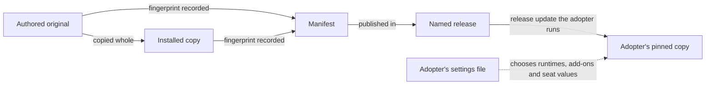

# Two runtimes, one contract

## Summary

A repository runs Claude Code, Codex or both, and its settings file names which. Both runtimes read one contract, one
set of skills and one set of seat charters, each through its own files. Use this page to see which file each runtime
reads, how the shared files reach a repository and which layer owns each file. It also covers native app runs, phone
notifications, native Windows and cloud sessions.

This page explains the runtimes and owns none of their rules. Each section names the home of the rules it explains,
and [Where the rules live](#where-the-rules-live) lists every home.

## Mental model

| What | Claude Code | Codex |
|---|---|---|
| The contract | `CLAUDE.md`, which imports `AGENTS.md` and adds Claude-only notes | `AGENTS.md`, read directly |
| Skills | `.claude/skills/`, a byte-identical copy of each skill | `.agents/skills/`, read directly |
| How a skill is invoked | `/{{NAME}}` | `${{NAME}}` |
| Seats | `.claude/agents/`, one Markdown file each | `.codex/agents/`, one TOML file each |
| Hook registration | `.claude/settings.json` | `.codex/hooks.json` |
| Hook scripts | `.claude/hooks/` | `.codex/hooks/` |
| Hook commands on native Windows | Run through Git Bash | Each handler's `commandWindows`, run through PowerShell |

A repository that runs one runtime holds only that runtime's column. Every shared file outside both columns belongs to
every install.

The preceding diagram follows one shared file from its author to an adopting repository. Each relationship, in order:

1. The canonical repository authors the original and copies it whole to its installed path.
2. The manifest records a fingerprint of the original and of the copy, committed with both.
3. A named release publishes the manifest-listed bytes.
4. An adopter takes those bytes only when it runs a release update to that release.
5. The adopter's own settings file, shown dotted, chooses which files it carries and which seat values differ.

No arrow means automatic distribution. A release changes what an adopter can take, never what it holds.

## How it works

### One contract, two sets of files

With both runtimes, the work switches to one when the other runs out of budget. Both read the same contract.
`AGENTS.md` holds it, and `CLAUDE.md` imports it and adds notes only Claude Code needs. The skills live once in
`.agents/skills/`, which Codex reads directly. `.claude/skills/` holds a byte-identical copy of each skill for Claude
Code. The copies are real files, not symlinks, because a symlink reaches a Windows checkout as plain text.

The seat files under `.claude/agents/` and `.codex/agents/` carry the same charter in each runtime's format.
[The seats](AI-WORKFLOW-seats.md#one-charter-on-two-runtimes) explains how a check keeps the two in step.

The safety hooks exist as twins, one set registered by each runtime's file.
[Enforcement and instruction](AI-WORKFLOW-enforcement.md#runtime-hooks) says which hook runs on which event. It also
says how Codex finds its hooks from every worktree, and why a registration does not prove that a hook ran.

Which runtime owns a file follows its path. Everything shared under `.claude/`, and `CLAUDE.md`, belongs to Claude Code.
Everything under `.codex/` belongs to Codex. `scripts/lib/runtimes.mjs` names the few scripts tied to one runtime.
Without a `runtimes` key, a repository runs both.

### Vendored skills and libraries

Some skills come whole from other repositories. Each upstream repository has its own folder under `.agents/upstream/`,
a verbatim copy kept with its licence. The canonical repository copies each installed skill whole from that folder. So
you invoke a vendored skill by the same name, and reach it by the same path, as a first-party one. Seventeen skills
come from upstream this way.

| Upstream repository | Commit | What it supplies | Kept in |
|---|---|---|---|
| mattpocock/skills | 24fe0ef7737efae15c87225755e9f6f5965e4888 | Thirteen skills | `.agents/upstream/mattpocock-skills/` |
| anthropics/claude-plugins-official | 44490cccaf6d9f82fdeec9416fbf7c9bd72575dc | `frontend-design`, from its `plugins/frontend-design/skills/frontend-design/` folder | `.agents/upstream/anthropics-claude-plugins-official/` |
| anthropics/knowledge-work-plugins | 2d6f7e22dd25593f0f748010430ef86f19659735 | `accessibility-review`, from its `design/skills/accessibility-review/` folder, with the licence from that repository's root `LICENSE` | `.agents/upstream/anthropics-knowledge-work-plugins/` |
| `supabase/agent-skills` | c9be0e931b7930f7d02126d04774d904c381e7d7 | `supabase` and `supabase-postgres-best-practices`, from its `skills/` folder, the complete skill trees with the repository's root MIT `LICENSE` | `.agents/upstream/supabase-agent-skills/` |
| squirrelchat/smol-toml, version 1.9.1 from its npm package | None: taken from the package | The TOML parser's CommonJS build, `dist/index.cjs`, with its BSD-3-Clause `LICENSE`. The closeout cleanup helper loads it to read Codex's settings | `.agents/upstream/squirrelchat-smol-toml/` |

Nobody edits a vendored copy. An upgrade replaces the upstream folder and every copy of it whole.

The accessibility skill links to a `CONNECTORS.md` two folders up from itself. Upstream keeps that file at
`design/CONNECTORS.md`, to explain the plugin's placeholders for connected tools. It is an optional reference the
workflow does not carry, so the link resolves to nothing by intent. From each of the skill's three copies it would
point outside the vendored folder, at a different place each time. The accessibility audit follows no connector note.

### How shared files travel

The canonical repository is the one the manifest names as `canonical`, and the only place anyone authors a shared
file. Each original lives under `src/`. The repository copies it whole to its installed path, and a skill also to its
`.claude/skills/` copy. `AGENTS.md` shares only the text between its `factory-shared` markers. The repository's own text
around them stays local.

The manifest, `.agents/factory-manifest.json`, records each shared file's fingerprint: its hash and its mode. In
`scripts/lib/factory-sync.mjs`, `computeEntries` records them and `verifyManifest` compares each installed file or
marked region with its record. The canonical repository commits the original, its copy and the manifest together, and a
test refuses a difference. In the canonical repository, `node scripts/factory-sync.mjs --write` records the
fingerprints. It refuses to run anywhere whose `origin` is not the canonical repository, so an adopter cannot record its
own changes as the shared text.

Publishing a release changes what adopters can take. Each adopter keeps a pinned copy at the release it installed or
last updated to. Its copy moves only when it runs a release update to a named release. That update installs the
manifest-listed bytes the release carries and records the release in the adopter's manifest. The canonical repository's
own installation tests run against synthetic releases in temporary repositories. They do not show a real adopter's
update.

An adopter's settings file decides which listed files it carries:

- **Runtimes.** A runtime the file does not name has no installed files.
- **Add-ons.** An install writes the external review add-on's files and the Herdr add-on's files only where the file
  turns each add-on on.
- **The documentation sweep.** Where the file turns the sweep off, an install leaves out the sweep check's six files
  and the documentation standard.
- **Seat values.** A seat setting the file names replaces the default value, and nothing else in the seat file.

The manifest keeps every entry either way. A path the settings leave out must hold nothing, and the contract test
refuses anything found there. The settings authorize no edit to a charter.
[The seats](AI-WORKFLOW-seats.md#seat-settings-in-an-adopting-repository) explains seat values.

### What the factory carries, what setup chooses and what stays yours

A working setup has three layers, and each has one owner.

| Layer | What it holds | Who changes it |
|---|---|---|
| The factory | The files `.agents/factory-manifest.json` lists: the contract, skills, seat charters, hooks and checks | Nobody in an adopting repository: a release update replaces them, and the contract test checks each against its fingerprint |
| What setup chooses | The settings file `.agents/factory-settings.json`, and the documents an install or the `fabraik-setup` skill writes for the repository | The repository: setup writes them once, and the repository edits them afterwards |
| What stays yours | Each person's own home instructions and settings for a runtime | The person: an install never reads, copies or changes them |

The settings file is JSON, and the repository owns it. An update reads it and never writes it. Its `version` is `1`,
and the settings check refuses any key it does not know. Its keys matter here because they decide which shared files
the repository carries and which optional owner modes it turns on.
[The `shared-files` skill](../.agents/skills/shared-files/SKILL.md#repository-settings-and-requirements) owns the
keys and how a later release update changes them.

Cross-family review is where the layers meet. A review by the other model family sends that family's provider the code,
the diff, the plan and the card. The settings file records the owner's yes to it as `"crossFamilyReview": true`.
So it travels with the repository on `main`. A person who clones the repository onto another machine finds it there,
and so does a fresh session, with no home setting carried across. Naming both runtimes does not record it. A session
that finds no yes asks the owner before it sends anything to the other family.

That yes authorizes sharing material with the other provider and nothing more. It answers no permission prompt.
Claude Code's shared allow list includes `Bash(git worktree add .claude/worktrees/*)`. So a matching job start gets
configuration approval, without auto mode's classifier judging it. For a plainly written command, the
`block-unsafe-git` hook refuses branch resets, force flags and paths that escape the worktrees folder. It also refuses
any form it cannot read. The hook reads command text, so it does not see extra arguments a wrapper such as `xargs`
supplies from input.

Cleanup gets its approval from the trusted root's hook, and no standing allowance grants it.
[Enforcement and instruction](AI-WORKFLOW-enforcement.md#cleanup-approval-from-the-trusted-root) explains the hook's
checks and what they assume. Individual `git worktree remove`, `git branch -d` and `rm` commands keep their usual
permissions. The session still verifies job identity, target ownership and that a target is disposable. An issue number
or a path does not establish ownership. The cleanup helper checks that a removal is safe and reports what it keeps.

The helper removes only the local branch, and the delivery command `gh pr merge --auto --squash --delete-branch`
removes the remote one. Given `--pr` with the pull request's address, the helper may delete the exact verified merged
head after git refuses it as not fully merged. [The `closeout` skill](../.agents/skills/closeout/SKILL.md) owns that
proof, its rechecks and the separate backup exception.

Every other command follows Claude Code's runtime mode and permissions, a person's own settings included. That holds
for the Codex command line too. Codex asks as its sandbox and approval policy decide, a network request included. The
operating system may ask as well, for example before a program reaches a protected folder. Each prompt gets its answer
where it appears. The yes in the settings file is not push authorisation either.

### Native Codex run chats

An authorized run in the native Codex app gives each card one visible chat in a managed worktree. The coordinator
verifies that chat and its worktree, binds the run and observes both guard refusals. It then follows actual results. It
never infers a wake or a phone delivery from a queued or completed turn. A fresh owner approval goes to an unbound
owner session, with the screenshot where one is required.

The Bash guard looks for the literal `fabraik-app-run` stem in a submitted command. Globs, variables, partial paths,
wrappers, substitutions and access outside the command can evade that check. Where both connection records are gone and
git proves them absent, the guard judges later commands as ordinary ones. The guard refuses direct removal of the
records while the connection is bound or unavailable. It is a safeguard for direct commands, not a security boundary.
[The run reference](../.agents/skills/resume/references/runs.md#native-codex-app-run) owns the steps, and keeps the
terminal and Claude Code routes.

### Native phone notifications

Four facts stay separate: the app supports notifications, a session has a sender tool, the account is set up, and a
notification reaches a phone.

[Claude Code Remote Control](https://code.claude.com/docs/en/remote-control#mobile-push-notifications) documents mobile
push while Remote Control is active. It needs the same account and organization, phone notification permission and the
push categories turned on. A connected terminal that is focused or in active use can suppress pushes. The workflow
requires Trusted Devices for its Claude Code run, not for every documented push. A session must discover an explicit
sender tool for itself. A missing sender tool does not show that the app lacks mobile support.

[OpenAI remote connections](https://learn.chatgpt.com/docs/remote-connections) documents mobile access, and task or
attention notifications, for supported connected hosts and accounts. The documented route pairs the mobile app through
a supported desktop app host. That host stays awake and online, signed in to the same ChatGPT account and workspace.
You set it up through the desktop app, not the command line. Its host requirements do not show that every other context
or account lacks notifications. [Notification controls](https://learn.chatgpt.com/docs/notifications) vary by surface.
Command-line notifications and outside programs do not establish a native phone route by themselves.

On either runtime, a terminal child that finishes does not establish a native phone route. A queued update, the
coordinator presenting it, a native turn completing and a notification arriving are separate observations. None of them
proves the next, and arrival needs someone to see it on the phone. A session's tools, account and settings can stay
unverified even where documentation describes support.
[The run reference](../.agents/skills/resume/references/runs.md#native-notification-capability) owns the capability
check and what a run requires.

### On native Windows

Both runtimes need Git for Windows. Claude Code runs its hook commands through Git Bash, with the Claude hooks
unchanged. `CLAUDE_CODE_GIT_BASH_PATH` points it at an install outside the default place. The `.sh` hooks and their
tests run through that install's `sh.exe`, which `scripts/lib/posix-shell.mjs` finds.

Codex uses each handler's `commandWindows` on Windows and runs it through the session's PowerShell. Each form keeps a
blocking hook's exit code through PowerShell, and a missing `node` cannot read as a pass. `.codex/hooks.json` holds the
forms, and the head of `scripts/lib/codex-hooks-windows.test.mjs` explains how each one works. The Stop hook's Windows
form runs `.codex/hooks/verify-green.mjs`. That script runs the same `verify-green.sh` through the shell it finds, and
blocks where it finds none. The `.sh` hooks need LF line endings, which each hook folder's own `.gitattributes` keeps.

`scripts/lib/codex-hooks-windows.test.mjs` runs each registered form through every PowerShell on the path. It skips
where it finds none. So it proves the repository's contract, not that a running Codex fired the hook. It proves that
contract on Windows only where continuous integration runs it on a Windows runner.
[The testing strategy](TESTING-STRATEGY.md) says which suites run where.

Codex trusts each handler by a fingerprint of its settings and its command. The settings are its event, matcher,
`timeout`, `async`, `statusMessage` and `additionalContextLimit`. The command is the one it runs on the current
platform: `commandWindows` on Windows where set, and `command` otherwise. Codex records that trust under the handler's
position in its event's list. The upstream source shows the
[command choice](https://github.com/openai/codex/blob/dfdb40cd0b72dfba3293db5c7c441232e8ef1a60/codex-rs/hooks/src/engine/discovery.rs#L503-L566)
and the
[`hook_hash`](https://github.com/openai/codex/blob/dfdb40cd0b72dfba3293db5c7c441232e8ef1a60/codex-rs/hooks/src/engine/discovery.rs#L766-L792)
in openai/codex.

| What changed | Where the hook needs approval again |
|---|---|
| `commandWindows` | Windows only |
| `command` | macOS and Linux, and Windows for a handler without `commandWindows` |
| Any other fingerprinted setting, a moved handler or a handler inserted ahead of it | Every platform |

[The `resume` skill](../.agents/skills/resume/SKILL.md#before-intake), under "Before intake", says how the owner trusts
a hook again on each affected platform.

### In a cloud session

A Claude Code cloud session runs from a fresh clone, on a machine the platform provides. `CLAUDE_CODE_REMOTE` reads
`true` there. Its GitHub requests pass through the platform's GitHub proxy. The proxy refuses every GraphQL request,
whatever the credential, and attaches no network secret to a GitHub request. So the board scripts cannot run there,
and no token given to the environment changes that. Codex has no cloud build.

The work therefore splits in two. A local session on the owner's machine keeps the board in step. It claims the card,
starts the cloud session, watches it, waits for its draft with `node scripts/merge-watch.mjs --draft job/{{ISSUE}}` and
delivers it. The cloud session plans, builds, reviews and opens the draft pull request under that claim. It builds
only a card that takes the pull request route. A local session builds a change the direct route to `main` admits.

The cloud session runs in auto mode, never Accept edits. Its environment holds no environment variables, no network
secrets and no credential in its setup script. In the Claude desktop app, the local session works from the app's
built-in browser on claude.ai/code. That page is the one place a cloud session shows, because the app's own session
tools do not list cloud sessions. A session without that browser gives the owner the start message to send. The owner
then confirms the stop.

No hook observes what either session does on GitHub or claude.ai. Each row names what a session or its browser does
there, and what bounds it.

| Who, and when | What it does, and its bound |
|---|---|
| The cloud session, on GitHub | It acts on GitHub as the owner, through tools no hook observes, so the skill's list of permitted writes is the only bound on what it publishes. |
| The local session, on claude.ai | It acts on claude.ai as the owner, through tools no hook observes, so the skill's Cloud build is the only bound on what it does there. |
| The local session, before each start | Before each start a script the session runs in the page, rather than a browser click, opens the chosen environment's settings, takes only whether its environment variables and setup script are empty and whether its summaries read as an empty environment's do, never what they hold, and presses Cancel; nothing else acts on or reads the page while that dialog is open, and where it stays open the session asks the owner to close it. The session goes on without asking where the script shows the environment empty and the dialog closed, starts nothing where it finds environment variables, and otherwise asks the owner to confirm the environment, naming what it could not confirm, as for network secrets, a setup script that holds anything or an organization's environment; that answer covers a later start of its own only where the check reads the same. |
| The local session, at the start | It starts the cloud session on `main`, in that environment and in auto mode, and reads all three back before it sends the start message. |
| The local session, while it watches | It looks at the cloud session's page about every ten minutes and tells the owner what it shows. Each look reads only the cloud session's status and last message, and the owner can sign out there whenever no cloud build is running. |
| The built-in browser, between sessions | The browser keeps sign-ins between sessions, so a later session there could read other cloud sessions without a prompt. |
| The local session, before an archive | Before an archive without asking, the session also reads the list of active sessions on the account, taking only each row's repository and time from the page as shown. |
| The local session, at the end | It archives each session once it has verified that the session stopped, then checks that the branch head is still the reviewed commit it verified. |

Every review runs in the cloud on Claude Code seats, and the pull request body declares it. So no Codex review follows
at delivery. A fix made after the review of the final tree gets a review scoped to it before the draft opens. The body
names the commit the last review covered.

Delivery checks where the draft came from. The wait reads only from origin, and accepts only one open pull request owned
by origin on that exact job branch. At takeover the local session resolves origin's identity again. It checks provenance
in the same GitHub command line context its body edit, readiness and merge use. It then checks the reviewed commit
against the fetched branch. So the check refuses a conflicting `GH_REPO` or default repository, even with a commit and
body copied from the intended draft. The admitted repository and job branch stay fixed. The check runs again after the
session enters the worktree. It also runs again after any change of working folder, or of the GitHub command line's
environment, sign-in, configuration or default repository. Each such change requires it before the next body edit,
readiness or merge.

| Step | Where it runs | The card's column after it |
|---|---|---|
| Pick, claim with the runtime `Claude Code cloud`, move the card, check the environment, start the cloud session on `main` in auto mode with a start message carrying the claim's address | A local session | In progress |
| Plan, build and review, with a scoped review of any fix made after the review of the final tree | The cloud session | In progress |
| Open the draft pull request, its body naming the commit the last review covered | The cloud session | In progress |
| Watch the cloud session and wait for the draft, starting a fresh session where `main` moved since the start message | The local session that started the build, or the next session, whose work-pick offers the card first | In progress |
| Verify origin and provenance, check the reviewed commit, archive each cloud session once verified stopped or confirmed by the owner, run convergence checks again, drive visual work, ask for push authorisation | The same local session | Awaiting push |
| Push, mark ready, queue auto-merge | The same local session | In review |
| Merge | The board's own Item closed workflow | Done |

| Check | In the cloud session | At local delivery |
|---|---|---|
| Git guard | Runs, as observed. It refuses a commit in the clone as the integration checkout, so the job runs in a worktree | Runs |
| Builder handoff check | Runs, as observed. It refuses a malformed builder dispatch | Runs |
| Turn-end check | Runs in the worktree, as observed. It refuses to end a turn on a lint error while `src/` has a pending change. The platform adds its own turn-end hook, which asks for untracked work to be committed and pushed. The session answers it only with the job's own commits | Runs |
| Git hooks | Switched on by `npm ci`, and run on every commit and push | Run |
| Claude Code seats | Run from `.claude/agents/`. A review seat that cannot be dispatched there stops the build | Not run again |
| Codex seats and cross-family review | None: there is no Codex command line, and the reviews run on Claude Code seats, declared in the pull request body | Not run |
| Convergence checks | Run, and the body quotes the receipts | Run again, since the receipts stay on the cloud machine |
| Visual verification | Not run | Run |
| Provenance and reviewed commit | Named in the body on a `Reviewed commit:` line, once a review has covered every commit | Origin, the exact job branch and its open state verified in the delivery context. The reviewed commit is checked against the fetched head, and checked again after a context change |

A card whose local session parks or ends before the draft opens keeps its claim. The next session offers its delivery
first. [The cloud build reference](../.agents/skills/resume/references/cloud-build.md#the-route) owns every step, the
cloud session control and the release of a cloud claim.

## Where the rules live

- [`AGENTS.md`](../AGENTS.md#runtime-notes) under "Runtime notes": which file each runtime reads, and that only the
  named runtimes' files are installed.
- [`AGENTS.md`](../AGENTS.md#shared-workflow-adoption) under "Shared workflow adoption": what is shared, where it is
  authored, how it reaches a repository and what an adopter's copy may differ in.
- [The `shared-files` skill](../.agents/skills/shared-files/SKILL.md): how shared files are kept and vendored copies
  refreshed, [canonical recording](../.agents/skills/shared-files/SKILL.md#canonical-recording), and
  [the settings file's keys](../.agents/skills/shared-files/SKILL.md#repository-settings-and-requirements) with what
  a repository needs.
- The head of `scripts/factory-sync.mjs`: the `--write` and `--render` commands, their output and their exit codes.
- The head of `scripts/lib/runtimes.mjs`: which shared path belongs to which runtime, and which paths the settings
  leave out.
- `.claude/settings.json` and `.codex/hooks.json`: Claude Code's shared allowances, which hook runs on which event and
  the Windows form of each Codex hook command.
- The head of `scripts/lib/codex-hooks-windows.test.mjs`: how each Windows form keeps a block a block.
- [The testing strategy](TESTING-STRATEGY.md): which suites run on which platform.
- [The `resume` skill](../.agents/skills/resume/SKILL.md#before-intake) under "Before intake": how a session checks
  that its hooks run, and what the owner does when they do not.
- [The `resume` skill](../.agents/skills/resume/SKILL.md#6-verify-and-review) under "6. Verify and review": how a
  session reads the recorded cross-family yes, and what it asks where none is recorded.
- [The cloud build reference](../.agents/skills/resume/references/cloud-build.md): which cards a cloud session builds
  and how. It also says what a local session does at each end, and how a cloud claim is released.
- [The run reference](../.agents/skills/resume/references/runs.md): native app runs and the notification capability
  check.
- [The `closeout` skill](../.agents/skills/closeout/SKILL.md): scratch provenance, the checked cleanup command and the
  exact branch exceptions.

## Failure modes

- **Codex fires no shell-command hook on Windows.** Two upstream limits stand, and trusting the hooks removes neither.
  Codex emits no `PreToolUse` event for shell commands on Windows (openai/codex#24453). Its shell payload there also
  wraps the command in a `powershell.exe -Command` string the git guard does not read.
- **A hook cannot run.** This happens where `node` is missing. It also happens where a Codex that finds no shell
  launches hooks through `cmd.exe /C`, which cannot read these forms. The runtime reports a failed hook and the action
  goes ahead, as a failed hook does on macOS. The failure is visible, not blocking.
- **A runtime has not trusted the hooks.** A hook file the runtime has not trusted does not run. A session checks for
  this when it starts and tells the owner. [The `resume` skill](../.agents/skills/resume/SKILL.md#before-intake) owns
  the check and the remedy.
- **A file of a runtime the repository does not run is in the tree.** The contract test refuses it by path.
  [The `shared-files` skill](../.agents/skills/shared-files/SKILL.md#repository-settings-and-requirements) says how to
  remove it or run that runtime instead.
- **A session asks about cross-family review after the owner said yes.** The yes counts only as
  `"crossFamilyReview": true` in `.agents/factory-settings.json` on `main`. A yes in an earlier conversation, a home
  setting or a file naming both runtimes records nothing. So the session asks once per job until the key reaches `main`.
- **A prompt appears although the owner authorized cross-family review.** That yes answers no permission prompt. Claude
  Code's shared rules approve matching job starts and the checked cleanup helper, within the limits of the command-text
  guard. Other commands follow the runtime mode and a person's own settings. Codex and the operating system each ask
  by their own rules.
- **Cleanup keeps a target despite its approval.** Approval removes no safety check and establishes no ownership. A
  merged-head exception without credentials or merge proof keeps the branch. An unsupported platform, unprovable process
  use or a running container bound to a parent of the job folder keeps the affected target. So does a failed Docker
  check. The session reports each kept target with its reason, and the workflow promises no platform a cleanup without help.
  [The `closeout` skill](../.agents/skills/closeout/SKILL.md) owns the Docker Desktop handling and the host check.
- **A board script fails in a cloud session.** The proxy refuses GraphQL. A cloud session never runs the board
  scripts, and a local session moves the card.
- **A cloud session cannot confirm its claim.** It builds nothing. A session may have released or withdrawn the claim
  its start message names, or a later claim followed it. Someone may also have closed the issue, or the job branch may
  already exist.
- **The cloud session's clone is not the `main` it fetched.** `main` moved between the clone and the session's own
  fetch. The cloud session stops before its admission and says so. Where the local session's fetch shows `main`
  moved since the start message, it archives that session and starts a fresh one, unasked. The same stop again goes
  to the owner.
- **The start form shows an earlier branch, environment or mode.** The form can keep an earlier session's choices. The
  local session chooses `main`, the checked environment and auto mode wherever the form shows something else. It leaves
  a choice the form already shows, since clicking a selected repository turns it off. It turns off any other repository
  the form keeps, and sends the start message only once the page shows all of them.
- **Claude Code refuses an action on claude.ai or asks for permission.** Claude Code's safety checks review each click and typed
  entry on an outside page. The session never works around a refusal: it asks the owner, whose answer covers that
  action. Claude Code reads a lasting allowance for its auto mode classifier only from a person's own or an
  organization's managed settings, never from a repository.
- **The local session cannot read the cloud session's page or verify its stop.** It says so, and the owner reports a
  stop. The owner confirms that every cloud session under the claim has stopped and is archived before delivery or
  release.
- **The platform subscribes the cloud session to its pull request's activity.** The cloud session turns that off once
  its finished draft is open. The local session archives it only once its page shows Auto-fix off for the draft.
  Otherwise it asks the owner, because no documentation says archiving alone stops those events.
- **A card goes back to `Ready` during a cloud build.** Releasing a claim stops no cloud session that is already
  building. So the session that moves the card first has every cloud session under the claim stopped and archived. It
  archives those it started once verified, and has the owner confirm any other. Only then does it release the claim,
  which keeps any later start message from building.
- **A cloud build turns out to be a direct-route change.** The cloud session opens no draft and tells the owner.
  The route carries only pull request changes. A local session builds such a card.
- **The platform reclaims a cloud machine.** Only pushed work survives, so the cloud session pushes its branch before it
  waits on the owner.
- **The local session ends before the draft opens.** The card keeps its `Claude Code cloud` claim in its column. The
  next session's work-pick offers its delivery first: waiting for the draft, or delivering it once open. That session
  did not start the cloud session, so the owner confirms its stop.
- **The wait ends without a draft.** Foreign or unknown provenance, several pull requests, unreadable replies
  or failed reads exit non-zero with the reason last. The session tells the owner and waits again on the owner's say.
- **Origin uses an SSH host alias.** The origin lookups need a real GitHub host that `gh` resolves directly. An alias
  may work in git but fail here. The session stops and asks the owner for a directly resolvable origin, rather than
  retrying what looks like a network error.
- **Takeover finds a foreign or unknown pull request.** Delivery stops, even where a conflicting GitHub command line
  context selects a copied commit and body. The fallback for an unfinished review requires verified provenance.
- **A verified draft names no reviewed commit, or not its branch's head.** Delivery stops and the session tells the
  owner. With verified provenance and the owner's say, a draft opened before the review of the final tree may finish on
  the local route. Its reviews then run there too. The session never delivers a branch that moved after its last review
  as reviewed.

## Key files

- `AGENTS.md` and `CLAUDE.md`: the contract, and Claude Code's import of it.
- `.agents/skills/` and `.claude/skills/`: the skills and their Claude Code copies.
- `.agents/upstream/`: the vendored skills and TOML parser, one folder for each upstream repository.
- `.agents/factory-manifest.json`: the list of shared files and their fingerprints.
- `.agents/factory-settings.json`: the repository's settings file.
- `.claude/agents/` and `.codex/agents/`: the seat files.
- `.claude/settings.json` and `.codex/hooks.json`: the hook registrations.
- `.codex/hooks/verify-green.mjs` and `scripts/lib/posix-shell.mjs`: the Windows route to the shell hooks.
- `scripts/lib/codex-hooks-windows.test.mjs`: the proof of the Windows registrations.
- `scripts/factory-sync.mjs` and `scripts/lib/factory-sync.mjs`: recording fingerprints, applying seat settings and
  checking the manifest.
- `scripts/lib/runtimes.mjs`: which shared path belongs to which runtime, which paths the settings leave out, and the
  check of the settings file's keys, `preApprovedRun` included.
- `scripts/merge-watch.mjs`: with `--draft`, the local session's wait for a cloud build's draft.
- `scripts/product-manager-run.mjs` and `scripts/lib/product-manager-run.mjs`: the Codex run launcher. It starts each
  card session and the end session in turn, and queues result references to the selected owner chat. `--pre-approved`
  marks sessions with one run start time, and the `--claude-card` mode runs one Claude Code card session. Neither route
  sets a factory expiry. A manual interruption still attempts bounded cleanup, and a native tool timeout leaves
  unresolved activity to handle.
- `scripts/lib/advance-approval.mjs`: reads the owner's advance approval on a card, and judges whether a pre-approved
  run session may publish. The `--approval check` mode of `scripts/board.mjs` prints its lines.

## Where to go next

- [Enforcement and instruction](AI-WORKFLOW-enforcement.md) explains what each hook refuses, and what rests on an
  instruction.
- [The seats](AI-WORKFLOW-seats.md) explains the seats each runtime defines, and how an adopter overrides seat values.
- [The life of one change](AI-WORKFLOW-job.md) shows where a cloud build and a native run fit in a job.
