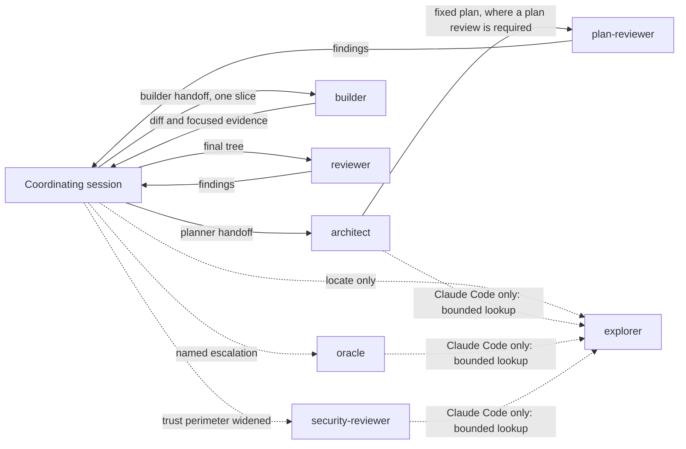

# The seats

## Summary

A seat is an agent role with a narrow charter and no more tools than that charter needs. Use this page to see which
seat does what in a job, and how work passes from one seat to another. Read it before you plan a job or settle a
review, so each piece of work reaches the seat built for it. The seat files hold each charter, and the
[`resume`](../.agents/skills/resume/SKILL.md) skill says when the session dispatches each seat.

The session that talks to the owner coordinates and never builds. It plans the cards that need no architect, hands
every edit to a builder seat, settles reviews and delivers. [`AGENTS.md`](../AGENTS.md#runtime-notes) sets that out
under "Runtime notes".

## Mental model

| Seat | What it does | Edits files? | Its report ends with |
|---|---|---|---|
| `explorer` | Locates code and returns findings with file and line references; judges nothing | No | No set line |
| `architect` | Plans a `plan-first` change, or one with design choices still open, cut into bounded builder handoffs | No | `plan delivered in full` |
| `plan-reviewer` | Reads the fixed plan before any build, for feasibility, scope, coherence and security | No | `plan review delivered in full` |
| `builder-lite` | Builds a mechanical slice that strong checks verify and that leaves no judgment | Yes | `final on-disk state = ...` |
| `builder` | Builds one bounded slice whose plan leaves no consequential judgment | Yes | `final on-disk state = ...` |
| `builder-max` | The builder charter at higher capability, chosen first where uncertainty or the cost of a defect warrants it | Yes | `final on-disk state = ...` |
| `reviewer` | Challenges the final diff and its evidence: correctness, honesty, dead code, grounding and conformance to the card | No | `review delivered in full` |
| `security-reviewer` | Reviews a change that widens a surface the `security review` row of the Surfaces table names | No | `security review delivered in full` |
| `oracle` | Reasons through one named unresolved problem: a novel design, an independent derivation or a stalled diagnosis | No | `brief delivered in full` |

The `explorer` and `builder-lite` seats run on cheaper models. Only the seats
[`AGENTS.md`](../AGENTS.md#runtime-notes) names under "Runtime notes" reach the costliest models. A builder's higher
capability never widens its scope. [Why it is shaped this way](AI-WORKFLOW.md#why-it-is-shaped-this-way) explains how
the agents choose a seat by the judgment a slice still holds.

## How it works

The preceding diagram shows who hands what to whom, and each seat name here links that seat's charter. The
coordinating session is the only seat that talks to every other seat. It sends the
[architect](../.claude/agents/architect.md) a planner handoff. Where the card requires a plan review, the fixed plan
goes to the [plan reviewer](../.claude/agents/plan-reviewer.md). A [builder-lite](../.claude/agents/builder-lite.md),
[builder](../.claude/agents/builder.md) or [builder-max](../.claude/agents/builder-max.md) receives one slice and
returns its diff with focused evidence. The [reviewer](../.claude/agents/reviewer.md) reads the final tree and returns
findings rather than fixes. A dotted arrow carries a dispatch only when its condition holds. A widened trust perimeter
calls the [security reviewer](../.claude/agents/security-reviewer.md), a location question the
[explorer](../.claude/agents/explorer.md), and a named escalation the [oracle](../.claude/agents/oracle.md). The three
dotted arrows into the explorer exist on Claude Code alone.

### Handoffs

Every dispatch to a builder is a filled copy of [the builder template](../.agents/templates/builder-handoff.md). It
carries the slice, its claim, the construction mode, the working directory and the files to edit. It also carries the
evidence, the observer, the independent oracle, the focused verification command and the stop condition. Every
dispatch to the architect is a filled copy of [the planner template](../.agents/templates/planner-handoff.md). It
carries the decision, the scope, the discovery, the judgment asked for, the deliverable and the stop condition.

The handoff hook refuses a handoff with a missing labelled line or an unfilled slot. It checks builder handoffs on both
runtimes, and architect handoffs on Claude Code. The hook checks shape only, never whether the plan is sound or
followed. A builder checks the same lines itself before it edits, and stops on a decision the plan left open.

A builder proves only its own slice. The full suite, every commit and the convergence evidence stay with the
coordinating session, as [the `resume` skill](../.agents/skills/resume/SKILL.md#5-build) says under "5. Build".
[Enforcement and instruction](AI-WORKFLOW-enforcement.md) explains how the hook works on each runtime.

### Discovery on each runtime

The architect, oracle and security reviewer each need located code before they judge. The two runtimes get it to them
in different ways.

| | Claude Code | Codex |
|---|---|---|
| Who asks the `explorer` | The seat itself, with one bounded lookup | The coordinating session, before the dispatch |
| When the seat judges | Once completed findings are in a named file | Once the session supplies completed findings and dispatches it again |
| What holds the limit | The handoff hook limits the seat's helpers to the `explorer`, and the charter bounds the lookup | Instruction only: inherited permissions set no per-seat limit |

On both runtimes, the explorer locates and the seat judges: the explorer never supplies the planning, reasoning or
trust judgment. [The `resume` skill](../.agents/skills/resume/SKILL.md#4-plan) owns these dispatches, under "4. Plan",
and the planner template carries either completed findings or the Claude Code lookup.

### One charter on two runtimes

Each seat has one charter, written once for Claude Code under `.claude/agents/` and once for Codex under
`.codex/agents/`. The two bodies must match, except for how each runtime invokes a skill: `/name` on Claude Code,
`$name` on Codex. A check compares them and checks the runtime settings around each body on their own. A repository's
own custom seat needs no counterpart on the other runtime, but the check still validates its definition.

### Plan review across model families

The `plan-reviewer` reads a `plan-first` card's plan before any builder starts. Normally the other model family
reviews it: a Claude-written plan goes to Codex, and a Codex-written plan to Claude. A writer's own family shares its
blind spots, so the other family is more likely to catch a plausible mistake. [The `resume`
skill](../.agents/skills/resume/SKILL.md#4-plan) owns which cards get the review, and [the `cross-review`
skill](../.agents/skills/cross-review/SKILL.md#4-review-a-plan-before-the-build) owns how it runs.

### Standards enter at planning

Every seat that plans, builds or reviews code reads the coding standards before it starts, as
[`AGENTS.md`](../AGENTS.md#coding-standards-and-the-executed-test-bar) says. The standards also set what a test or tool
may cost, and the plan makes that choice. A builder cannot change a plan once it arrives. So a standard read only at
build time reaches the work after the plan fixes its design, and a finding then costs a replan.

### Seat settings in an adopting repository

Each seat file sets its seat's model and effort, and on Claude Code its turn limit. Those values are defaults. An
adopting repository may name another value for a seat in its own seat settings file. An override changes a value the
seat file already carries, never its instructions. A render command applies that file
to the seat files, and every release update applies it again. A guide page that names a seat's model names the
default. [The `shared-files` skill](../.agents/skills/shared-files/SKILL.md#repository-settings-and-requirements) owns
how a repository overrides a seat and what an override may not do.

## Where the rules live

- The seat files under `.claude/agents/` and `.codex/agents/`: each seat's charter, tools, model, effort and turn limit.
- [`AGENTS.md`](../AGENTS.md#runtime-notes) under "Runtime notes" and "Codex model routing": which seats exist, which
  seats reach the costliest models and how the session dispatches a seat.
- [`AGENTS.md`](../AGENTS.md#coding-standards-and-the-executed-test-bar) under "Coding standards and the executed test
  bar": which seats read the coding standards.
- [The builder template](../.agents/templates/builder-handoff.md) and
  [the planner template](../.agents/templates/planner-handoff.md): the labelled lines of each handoff, and what to do
  with a capped builder.
- [The `resume` skill](../.agents/skills/resume/SKILL.md#4-plan) under "4. Plan" and "5. Build": who plans, which plans
  get a review, which builder takes a slice and what a builder may run.
- [The `cross-review` skill](../.agents/skills/cross-review/SKILL.md): how a review or a plan review runs on the other
  model family.
- [The `shared-files` skill](../.agents/skills/shared-files/SKILL.md#repository-settings-and-requirements): how a
  repository overrides a seat, and the limits on an override.

## Failure modes

- **A seat reaches its turn limit.** A seat stops at its limit with no warning, so its report lacks the finish
  line the table in [Mental model](#mental-model) gives. The session treats that report as capped and never resumes the
  seat. A capped builder's remaining work goes to a fresh builder as a smaller slice, and the session never finishes it
  by hand. A capped architect, oracle or security reviewer leaves its settled points in its result file. The session
  then dispatches one fresh seat for the open points, or finishes the result inline.
- **A handoff leaves a decision open.** The plan settles judgment that would make a handoff unreliable, or the session
  splits the slice smaller. The session never absorbs it by editing, and a builder that meets it stops and asks.
- **A handoff is incomplete.** The handoff hook refuses it. On Codex it also refuses a builder dispatch with no saved
  handoff, and every tool call of a builder thread that started without one.
- **A handoff is complete but wrong.** The hook passes it, because it checks shape only. The plan review, the builder's
  own stop rule and the final review catch a wrong handoff instead.
- **The plan-review seat is unreachable.** Another seat reviews the plan and the pull request body says so.
  [The `resume` skill](../.agents/skills/resume/SKILL.md#4-plan) owns that route under "4. Plan".
- **The two runtimes' charters differ.** The commit check names the seat, both files and the differing lines. A builder
  corrects both charters together at their source, and an adopter receives the correction through a release update.
- **A seat file and the seat settings file disagree.** The contract test fails, naming the seat, until the render
  command applies the settings file and the session commits the result. Every command that applies the settings
  file refuses one that breaks an override limit before it writes anything.

## Key files

- `.claude/agents/` and `.codex/agents/`: the seat files.
- `.agents/templates/builder-handoff.md` and `.agents/templates/planner-handoff.md`: the handoff templates.
- `.claude/hooks/check-builder-handoff.mjs` and `.codex/hooks/check-builder-handoff.mjs`: the handoff hooks, which share
  `scripts/lib/handoff-check.mjs`.
- `scripts/lib/check-agents.mjs`: the check that compares charters across the runtimes.
- `scripts/lib/seat-settings.mjs`: the seat settings file's path, schema and what it refuses.
- `docs/CODING-STANDARDS.md`: the standards every planning, building and reviewing seat reads.

## Where to go next

- [The life of one change](AI-WORKFLOW-job.md) shows where each seat acts in a job.
- [The evidence bar](AI-WORKFLOW-evidence.md) explains what a builder's report must prove.
- [Enforcement and instruction](AI-WORKFLOW-enforcement.md) separates what the handoff hook refuses from what rests on
  an instruction.
