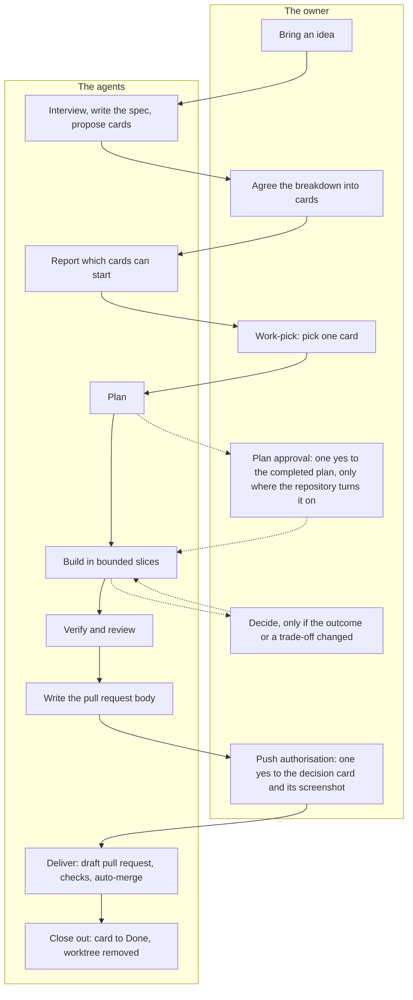

# The software factory

This workflow lets AI agents build and maintain software in a git repository while the owner makes the decisions that
matter. Use this page to see the whole workflow at once, and to find the page that answers your question.

The owner decides what to build and whether a finished change may ship. A repository may also ask the owner to approve
each completed plan before the agents build it. Agents do the rest of the work, and tests and reviews the agents cannot
skip check it. Each step leaves a record the owner can read without reading code.

What the agents build is ordinary source code in a git repository, with its own architecture, tests, history and review.
Any developer with access can read, run and extend it. Every decision reaches the owner in plain language, so steering
the work never depends on reading a diff. Plain language changes who can steer the work, not how the agents build it. A
developer owner can still read every diff, and the same plans, standards, tests and reviews apply to every owner.

This guide explains the workflow and owns no rule. [`AGENTS.md`](../AGENTS.md) is the index every agent loads: it
holds the rules every session needs and names the home of every other rule. The skills under `.agents/skills/` own
the exact steps and commands. Where this guide and a rule's home disagree, the home is right.

## The map

The owner reads short decision cards and screenshots, not diffs. So the workflow puts two decisions in front of the
owner in plain language, and a third where the repository turns plan approval on.

The diagram sets the owner's steps beside the agents' steps for one piece of work, from an idea to a merged change.
Solid arrows show the usual path. The dotted pair from planning applies only where the repository turns plan approval
on. The dotted pair from building applies only when the approved outcome or a trade-off changes during the build.

In order, the path runs like this. The owner brings an idea. The agents interview the owner, write the spec and
propose cards, and the owner agrees the breakdown. The agents report which cards can start, and the owner picks one:
that pick is work-pick, the first decision. The agents plan, build in bounded slices, verify, review and write the
pull request body. The owner reads a short decision card taken from that body, with a screenshot when the change is
visible. The owner may ask to see the whole body. The owner's yes is push authorisation, the second decision, and the
owner has not accepted a material limit the card leaves out. The agents then deliver and close out without asking
again.

Between the two decisions, a question goes back to the owner in two cases only. Where the repository turns plan
approval on, the agents present the completed plan and build nothing until the owner says yes. When the approved
outcome or a trade-off changes during the build, the agents ask before they build it. A change the repository's own
gate admits whole goes straight to `main` on the same yes, with no pull request.

[`AGENTS.md`](../AGENTS.md#owner-gates) owns what each decision approves, what turns plan approval on and what still
needs its own approval, under "Owner gates". Where the repository turns product manager mode on, the owner may hand
work-pick to a product manager run, which [The life of one change](AI-WORKFLOW-job.md) describes. Underneath this path,
every job runs in its own worktree and every check logs its exit code. A short list of machine guards holds what a
sentence could not.

### What is shared and what stays local

The workflow reaches a repository as the shared files its manifest, `.agents/factory-manifest.json`, lists. Everything
else belongs to the repository itself. Its product, its profile in `.agents/REPOSITORY.md` and the Surfaces table at the
end of `AGENTS.md` sit outside the shared files. So do its settings file, board values, package commands, continuous
integration and optional gates. [Two runtimes, one contract](AI-WORKFLOW-runtimes.md) explains which layer owns what.
[`AGENTS.md`](../AGENTS.md#shared-workflow-adoption) owns how the shared files reach a repository, under "Shared
workflow adoption".

## Where to read what

Each row names a question and the one page that answers it. Every topic page has the same sections, which
[`AGENTS.md`](../AGENTS.md#sources-of-truth) lists under "Sources of truth". So a topic's rules, failure modes and key
files are always in the same place.

| If you want to know | Read |
|---|---|
| What the owner decides, and when | [The map](#the-map), then [`AGENTS.md`](../AGENTS.md#owner-gates) under "Owner gates" |
| Why the workflow has this shape, from requirements to maintenance | [Why it is shaped this way](#why-it-is-shaped-this-way) |
| How an approved card becomes a merged commit | [The life of one change](AI-WORKFLOW-job.md) |
| Who does what, and how one agent hands work to another | [The seats](AI-WORKFLOW-seats.md) |
| How the agents file, track and move planned work, on GitHub or another board | [The board](AI-WORKFLOW-board.md) |
| What a machine refuses, and what rests on an instruction alone | [Enforcement and instruction](AI-WORKFLOW-enforcement.md) |
| What counts as proof that a change works, and what a passing check cannot show | [The evidence bar](AI-WORKFLOW-evidence.md) |
| How Claude Code and Codex share one workflow, which layer owns each file, and what changes on Windows or in a cloud session | [Two runtimes, one contract](AI-WORKFLOW-runtimes.md) |
| What a pull request description holds, and what its review line means | [The review line](#the-review-line) |
| Why a repository has not received a change to the shared workflow | [`AGENTS.md`](../AGENTS.md#shared-workflow-adoption) under "Shared workflow adoption", then the [`shared-files`](../.agents/skills/shared-files/SKILL.md) skill |
| What is true of one repository alone: its product, own facts, grounding authorities and conventions | [`.agents/REPOSITORY.md`](../.agents/REPOSITORY.md) |
| What happens to a file, worktree or branch another job left behind | [Leftover rule](../.agents/skills/closeout/SKILL.md#leftover-rule) in the `closeout` skill, and its [Disposable job cleanup](../.agents/skills/closeout/SKILL.md#disposable-job-cleanup) section for the authority to delete one |
| The exact steps of a job | The [`resume`](../.agents/skills/resume/SKILL.md) and [`closeout`](../.agents/skills/closeout/SKILL.md) skills, and the external review add-on's own skill where [the add-on](#the-external-review-add-on) is on |
| What a term means | [The glossary](../GLOSSARY.md) |
| Where every other document is, and what each is for | [The document index](../docs/README.md) |

## Why it is shaped this way

An AI agent's typical failure is a plausible mistake, not a visible one. It writes a result that is consistent and
wrong, or a test that passes whatever the code does. It writes a pull request description that overstates what was
verified. The workflow answers that failure in three ways.

- **Slice by blast radius.** The agents cut work by how many behaviours, sources of truth and consumers a change can
  affect, not by file size. Each slice makes one verifiable claim, fits one build context and declares the files it
  owns. A one-line change to a shared resolver is riskier than a long isolated document. [The `resume`
  skill](../.agents/skills/resume/SKILL.md#4-plan) owns how the agents size a card before work-pick, and the one split
  it allows afterwards, under "4. Plan".
- **Route capability by the judgment that remains.** After planning, the agents weigh the design choices still open and
  how much is unknown. They also weigh how bad a plausible defect would be, and how well tests can catch a weak build. A
  bounded builder takes work with no judgment left. The agents settle remaining judgment in the plan or split the
  slice, and the session never absorbs it by editing directly. Cost breaks ties only between equally reliable routes.
  Only the few seats [`AGENTS.md`](../AGENTS.md#runtime-notes) names under "Runtime notes" reach the costliest models.
  Seats that locate code or make mechanical edits run on cheaper models, as [The seats](AI-WORKFLOW-seats.md) shows.
  The workflow intends that saving but does not measure it: no workflow document records the cost it saves, or equal
  quality at lower cost.
- **Treat evidence honestly.** A green check proves only what that check covers. A review with no comments is not a
  completed review. The agents report missing evidence as unavailable, never as a pass or a zero.

### From requirements to maintenance

The workflow covers the life of the code, not one change alone. Each stage leaves a record the next stage reads: the
spec, the cards and their acceptance criteria, the plan, the commits and the recorded evidence.

- **Requirements.** When an idea needs its requirements found, the owner can start [the `grill-me`
  skill](../.agents/skills/grill-me/SKILL.md). It interviews the owner in rounds, each question with a recommended
  answer, until both sides confirm a shared understanding. [The `to-spec` skill](../.agents/skills/to-spec/SKILL.md)
  then writes the spec from that conversation. [The `to-issues` skill](../.agents/skills/to-issues/SKILL.md) cuts the
  spec into thin vertical slices, each demonstrable on its own and sized to one bounded build. The owner approves that
  breakdown before the agents file any card. A single bug or idea can instead become one card through the same
  approval. The owner judges outcomes, never code: `to-issues` owns what the agents ask the owner and what they decide,
  under ["Specification entry"](../.agents/skills/to-issues/SKILL.md#specification-entry). [The issue tracker
  page](ISSUE-TRACKER.md) says where the spec and its cards live.
- **Delivery.** The owner picks a card at work-pick. The agents plan it, build it in bounded slices, verify it, review
  the final tree and repair what the review finds. They deliver it on the owner's push authorisation. [The life of one
  change](AI-WORKFLOW-job.md) follows it stage by stage.
- **Maintenance.** The agents plan and review each feature against the same standing documents as the last, as [How
  focused work stays coherent](#how-focused-work-stays-coherent) explains. When the owner chooses, [the
  `improve-codebase-architecture` skill](../.agents/skills/improve-codebase-architecture/SKILL.md) looks for structure
  that makes the code hard to test or to navigate. It explains each candidate and recommends one, and the owner chooses
  which to explore. Nothing schedules it. [The `diagnosing-bugs` skill](../.agents/skills/diagnosing-bugs/SKILL.md)
  recommends it when a bug has no good place for a test, or its cause is architectural.

### How focused work stays coherent

Each working context holds one task, so it carries what that task needs rather than the whole job. Three mechanisms
hold the narrow pieces together, each with a cost, and narrow contexts still lose some detail.

- **Durable records carry continuity.** A seat has a narrow charter, and a builder receives one slice. Discovery wider
  than a couple of files goes to the `explorer` seat, so its conclusion reaches the session and its file listings do
  not. [`AGENTS.md`](../AGENTS.md#runtime-notes) sets this out under "Runtime notes". What a later context needs lives
  outside any one context: the card, the spec, the plan, the code with its git history, and the evidence.
- **Narrow contexts still lose detail.** A handoff carries only what its writer put in it. The handoff hook checks that
  each labelled line is filled, not that it is right. A builder that meets a decision the plan left open stops and
  asks, as [The seats](AI-WORKFLOW-seats.md) describes. A context compaction can drop detail too, so
  [`AGENTS.md`](../AGENTS.md#compact-instructions) names what a summary keeps. Its
  ["Owner gates"](../AGENTS.md#owner-gates) section makes the session ask an approval again once its question is out
  of view. Whether a slice fits one context is a judgment the plan makes, not a measured limit. The cost is more
  handoffs, each a place where information can be lost.
- **Standing documents carry consistency.** Plans, builds and reviews follow [the coding standards](CODING-STANDARDS.md)
  and [the testing strategy](TESTING-STRATEGY.md). Where the project has a user interface, they also follow [the design
  system](DESIGN-SYSTEM.md). So naming, structure, evidence and interface patterns carry from one feature to the next,
  and no session has to remember earlier work. The documents enter at planning, because a
  builder cannot change a plan once it arrives. [`AGENTS.md`](../AGENTS.md#coding-standards-and-the-executed-test-bar)
  says which seats read them. They cost upkeep, and they help only as far as plans and reviews apply them.
- **Independent review challenges what a writer cannot see.** A writer rarely finds the plausible mistakes in its own
  work. A model of the same family tends to make the same ones. A plan-first card's plan gets a read-only review before any
  build. At the `code` and `sign-off` tiers, the model family that did not write the change reviews the
  final tree. That reviewer derives the claims from the card and the final diff before it reads the selected evidence,
  as [the testing strategy](TESTING-STRATEGY.md#4-construction-modes) says. A detail a handoff lost, or an assumption
  the writer and the plan shared, can still surface that way. Where [the external review
  add-on](#the-external-review-add-on) is on, a `sign-off` change gets one more review. When the other family cannot
  review, the same charter runs on the writer's own family, and the pull request body says so. [The `resume`
  skill](../.agents/skills/resume/SKILL.md#6-verify-and-review) owns when that happens, under "6. Verify and review".
  Review lowers the chance that a mistake ships but does not remove it, and every pass costs model usage and time.

These are design intent, recorded with their reasons and costs. They do not guarantee correct or secure code, lossless
context or lower cost. No workflow document records a measurement of context retention, model cost or review yield
against another way of working. [The evidence bar](AI-WORKFLOW-evidence.md) explains what a passing check can and
cannot show.

## The rules that hold everywhere

Eight things hold in every repository that carries the workflow. They are what transfers to another product, so a
reader adapting the workflow looks for them first. Each item names the idea, and its link leads to the home that
states the rule:

1. One contract file every runtime reads, with skills for the steps and hooks for the guards:
   [`AGENTS.md`](../AGENTS.md).
2. Owner decisions in plain language: [`AGENTS.md`](../AGENTS.md#owner-gates) under "Owner gates".
3. One worktree per card, and a draft pull request the platform merges for each change off the direct route.
   The rules live in [`AGENTS.md`](../AGENTS.md#runtime-notes) under "Runtime notes" and
   [`AGENTS.md`](../AGENTS.md#publication-and-machinery) under "Publication and machinery".
4. Narrow seats, bounded handoffs and judgment settled in the plan:
   [`AGENTS.md`](../AGENTS.md#runtime-notes) under "Runtime notes".
5. One construction mode per claim, with exit codes a script records: [the testing strategy](TESTING-STRATEGY.md).
6. One fresh review of the final tree, its depth set by two questions about risk:
   [`AGENTS.md`](../AGENTS.md#review-and-visual-verification) under "Review and visual verification".
7. A board, git and documentation as three distinct stores, reconciled rather than assumed consistent:
   [`AGENTS.md`](../AGENTS.md#sources-of-truth) under "Sources of truth".
8. Evidence limits as visible as evidence successes:
   [`AGENTS.md`](../AGENTS.md#sources-of-truth) under "Sources of truth".

Each product adds its own protections in the Surfaces table at the end of `AGENTS.md`. There it names its
highest-consequence invariants and its own answers to the two review questions.

## The review line

Every pull request the `resume` skill delivers carries exactly one review line. The line makes the review that ran
before the pull request opened readable on GitHub. The Review section of [the pull request
template](../.github/pull_request_template.md) specifies its format. Any tool that writes or parses the line follows
it, in any repository, and a tool that disagrees with it is the defect. Where they run, the documentation sweep and its
day-after triage run no review before their pull requests open, so they carry no line.

The line sits in the Review section of a pull request body with five sections. The session writes the body with the
vendored `pr` skill. The body leads with what the owner decides on, and three collapsed parts keep the full supporting
evidence in the same body.

| Section | What it holds |
|---|---|
| Summary | The outcome in a few plain sentences, with a picture, a diagram, a tree or a diff sketch only where it shows something the sentences cannot |
| Not done | Anything skipped, deferred or uncertain |
| Merge Danger | The two answers the tier was chosen from, each with its reason. For a change whose parts answer the two questions differently, they are the answers of the part that set the tier, named in each reason, with one sentence on what the other parts take |
| Evidence | A before and an after, the screenshots of a visual change among them, and the plain Passed, Failed and Untested lines. Then, collapsed, the receipts a script wrote and any record of a carried receipt |
| Review | The review line and any declaration of how a review ran. Then, collapsed, the fresh reviewer's verdict, every finding with its disposition, and one usage line for each reviewer pass the Usage view cannot show, as the `cross-review` skill specifies; raw usage blocks stay out of the body. A third collapsed part keeps the decision card the owner answered, which the weekly retro's card check reads |

The `pr` skill carries a template of its own. Where it differs from `.github/pull_request_template.md`, the
repository's template wins. [The `resume` skill](../.agents/skills/resume/SKILL.md#7-push-authorisation-owner-gate-two)
owns that rule, under "7. Push authorisation".

### The external review add-on

The external review is an optional add-on, off unless the repository's settings file holds `"greptile": true`. It adds
a second, independent review of a `sign-off` tier change by Greptile, an outside review service. The session requests
it on the draft pull request after the cross-family review. A repository with the add-on off carries none of the
add-on's files, and requests and waits for no external review. Its `sign-off` tier is the cross-family review alone,
and its review line holds the six base fields.

The owner chooses the add-on at install, after connecting the repository to Greptile in Greptile's own dashboard. No
install does that connection. A release update run with the changed setting uncommitted writes or removes the add-on's
files later. The owner connects or disconnects the repository in that dashboard by hand, as [the `shared-files`
skill](../.agents/skills/shared-files/SKILL.md) says.

Where the add-on is on, the install writes two things. The `greptile` skill owns how a review is requested and
settled, when an exhausted allowance skips the request, and when an attempt counts as `UNAVAILABLE`. The reviewer's
configuration keeps Greptile to the reviews a session requests. [The `resume`
skill](../.agents/skills/resume/SKILL.md#6-verify-and-review) owns when the review runs and how a session reads the
setting, under "6. Verify and review".

## Where to go next

- [The life of one change](AI-WORKFLOW-job.md) follows one card from the owner's pick to a merged commit.
- [The seats](AI-WORKFLOW-seats.md) shows who acts at each stage, and how work passes between them.
- [Enforcement and instruction](AI-WORKFLOW-enforcement.md) separates what a machine refuses from what rests on an
  instruction.
